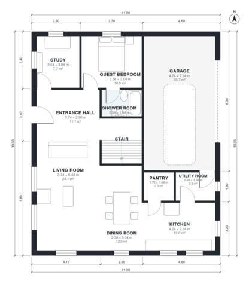

# 210 Square Meter House Plans: 5 Bed, 3 Bath, 2,180 Sq Ft

This is a compact two-storey home of about 205 m² of living space plus an attached garage, on an 11.2 x 13.3 m footprint. The ground floor has an open kitchen, dining and living area, a pantry, utility room, study, guest bedroom with shower room, and a 2-car garage entered through the utility room. Upstairs, a central landing leads to the primary suite with ensuite and walk-in closet, three more bedrooms and a family bathroom.

| | |
|---|---|
| Levels | 2 |
| Footprint | 11.2 m × 13.3 m (37 ft × 44 ft) |
| Rooms | 20 indoor, 1 outdoor |
| Indoor area including garage, from the room grid | about 241 m² (2,592 sq ft) |

## Files here

- `area-schedule.csv` (room schedule)
- `building.json` (rooms, walls, openings as data)
- `plan-level1.dxf` (floor plan, DXF, drawing units: millimetres)
- `plan-level2.dxf` (floor plan, DXF, drawing units: millimetres)

## More for this plan

- Plan page with the PDF plan set, IFC and 3D model, and a tool to change the plan: https://floorplan.ai-architectures.com/house-plans/210-square-meter-house-plans?utm_source=github-plans&utm_medium=probe&utm_campaign=github
- PDF plan set: https://storage.googleapis.com/20img/house-plans/210-square-meter-house-plans/plan-set.pdf
- IFC model: https://storage.googleapis.com/20img/house-plans/210-square-meter-house-plans/model.ifc

## Known issues in this drawing

- Dining Room is only 2.38 m wide.
- Bedroom 3 is 9.1 m² (asked for about 12.5 m²).
- Bedroom 3 is only 2.44 m wide.
- Bedroom 2 is only 2.44 m wide.

Concept design generated with AI. Not for construction or permit; verify with a licensed professional.
