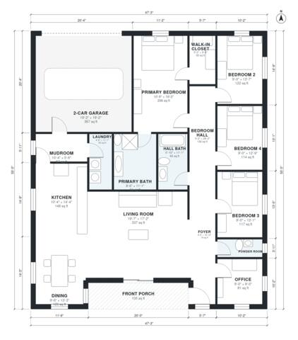

# 2100 Sq Ft House Plans: 4-Bed Single-Story with Office

This is a single-storey, 4-bedroom, 2.5-bath modern farmhouse with about 2,100 sq ft of living space. The garage and porch add roughly 485 sq ft more. An open kitchen, dining and living area runs across the back of the house. The bedrooms and primary suite sit together on a private hall, and the office and powder room are next to the entry. A mudroom and laundry connect the 2-car garage to the kitchen.

| | |
|---|---|
| Levels | 1 |
| Footprint | 14.4 m × 16.9 m (47 ft × 55 ft) |
| Rooms | 17 indoor, 1 outdoor |
| Indoor area including garage, from the room grid | about 234 m² (2,514 sq ft) |

## Files here

- `area-schedule.csv` (room schedule)
- `building.json` (rooms, walls, openings as data)
- `plan-level1.dxf` (floor plan, DXF, drawing units: inches)

## More for this plan

- Plan page with the PDF plan set, IFC and 3D model, and a tool to change the plan: https://floorplan.ai-architectures.com/house-plans/2100-sq-ft-house-plans?utm_source=github-plans&utm_medium=probe&utm_campaign=github
- PDF plan set: https://storage.googleapis.com/20img/house-plans/2100-sq-ft-house-plans/plan-set.pdf
- IFC model: https://storage.googleapis.com/20img/house-plans/2100-sq-ft-house-plans/model.ifc

## Known issues in this drawing

- None found by the automatic checks.

Concept design generated with AI. Not for construction or permit; verify with a licensed professional.
