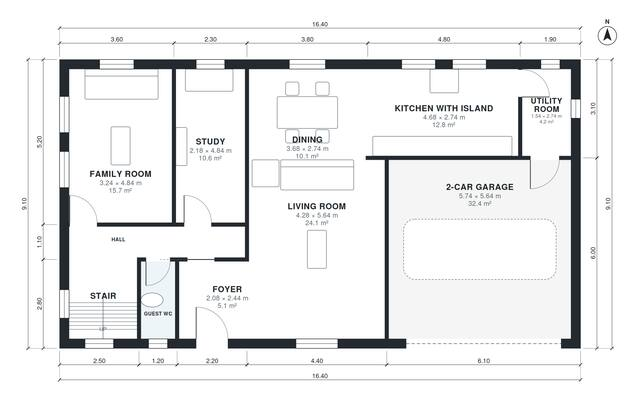

# 220 Square Meter House Plans: 4 Bed, 2-Story, 2-Car Garage

A compact two-storey, 4-bedroom, 3.5-bath home of about 220 m² of living space, plus an attached 2-car garage. The ground floor has an open kitchen with island, dining and living area, a family room, a study, a guest WC and a utility room with garage access. Upstairs are the primary suite with a dressing room and ensuite, three more bedrooms and two baths, with a terrace over the garage.

| | |
|---|---|
| Levels | 2 |
| Footprint | 16.4 m × 9.1 m (54 ft × 30 ft) |
| Rooms | 21 indoor, 1 outdoor |
| Indoor area including garage, from the room grid | about 260 m² (2,799 sq ft) |

## Files here

- `area-schedule.csv` (room schedule)
- `building.json` (rooms, walls, openings as data)
- `plan-level1.dxf` (floor plan, DXF, drawing units: millimetres)
- `plan-level2.dxf` (floor plan, DXF, drawing units: millimetres)

## More for this plan

- Plan page with the PDF plan set, IFC and 3D model, and a tool to change the plan: https://floorplan.ai-architectures.com/house-plans/220-square-meter-house-plans?utm_source=github-plans&utm_medium=probe&utm_campaign=github
- PDF plan set: https://storage.googleapis.com/20img/house-plans/220-square-meter-house-plans/plan-set.pdf
- IFC model: https://storage.googleapis.com/20img/house-plans/220-square-meter-house-plans/model.ifc

## Known issues in this drawing

- Bedroom 3 is only 2.44 m wide.
- Bedroom 4 is only 2.20 m wide.

Concept design generated with AI. Not for construction or permit; verify with a licensed professional.
