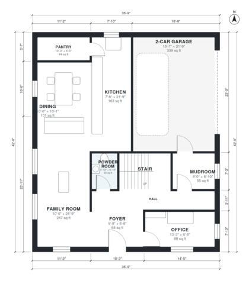

# 2200 Sq Ft 4 Bedroom House Plans: Two-Story With Office

A two-story, 4-bedroom home of about 204 m² (2,200 sq ft) of living space, plus an attached 2-car garage of about 38 m². The ground floor has an open kitchen with pantry, dining and family room, a front office, a powder room and a mudroom entry from the garage. Upstairs are a primary suite with walk-in closet, three more bedrooms, a hall bath and a laundry room.

| | |
|---|---|
| Levels | 2 |
| Footprint | 10.9 m × 12.8 m (36 ft × 42 ft) |
| Rooms | 21 indoor, 1 outdoor |
| Indoor area including garage, from the room grid | about 243 m² (2,618 sq ft) |

## Files here

- `area-schedule.csv` (room schedule)
- `building.json` (rooms, walls, openings as data)
- `plan-level1.dxf` (floor plan, DXF, drawing units: inches)
- `plan-level2.dxf` (floor plan, DXF, drawing units: inches)

## More for this plan

- Plan page with the PDF plan set, IFC and 3D model, and a tool to change the plan: https://floorplan.ai-architectures.com/house-plans/2200-sq-ft-4-bedroom-house-plans?utm_source=github-plans&utm_medium=probe&utm_campaign=github
- PDF plan set: https://storage.googleapis.com/20img/house-plans/2200-sq-ft-4-bedroom-house-plans/plan-set.pdf
- IFC model: https://storage.googleapis.com/20img/house-plans/2200-sq-ft-4-bedroom-house-plans/model.ifc

## Known issues in this drawing

- Laundry is only 1.48 m wide.
- Bedroom 3 is 8.9 m² (asked for about 13.0 m²).

Concept design generated with AI. Not for construction or permit; verify with a licensed professional.
