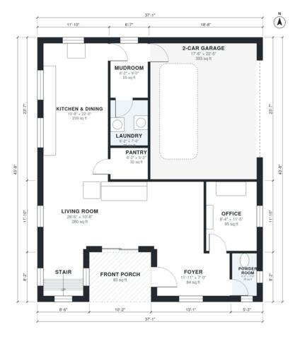

# 2200 Sq Ft House Plans: 4-Bed Two-Story with Office & Porch

A two-story modern farmhouse of roughly 205 m² (about 2,200 sq ft) of living space, plus a 40 m² two-car garage. The ground floor has an open kitchen, dining and living area, an office, a powder room, and a mudroom with laundry off the garage. Upstairs are four bedrooms, including a primary suite with a bath and walk-in closet, plus a hall bath.

| | |
|---|---|
| Levels | 2 |
| Footprint | 11.3 m × 13.3 m (37 ft × 44 ft) |
| Rooms | 20 indoor, 2 outdoor |
| Indoor area including garage, from the room grid | about 242 m² (2,605 sq ft) |

## Files here

- `area-schedule.csv` (room schedule)
- `building.json` (rooms, walls, openings as data)
- `plan-level1.dxf` (floor plan, DXF, drawing units: inches)
- `plan-level2.dxf` (floor plan, DXF, drawing units: inches)

## More for this plan

- Plan page with the PDF plan set, IFC and 3D model, and a tool to change the plan: https://floorplan.ai-architectures.com/house-plans/2200-sq-ft-house-plans?utm_source=github-plans&utm_medium=probe&utm_campaign=github
- PDF plan set: https://storage.googleapis.com/20img/house-plans/2200-sq-ft-house-plans/plan-set.pdf
- IFC model: https://storage.googleapis.com/20img/house-plans/2200-sq-ft-house-plans/model.ifc

## Known issues in this drawing

- Foyer is 7.8 m² (asked for about 11.0 m²).
- Bedroom 2 is only 2.14 m wide.

Concept design generated with AI. Not for construction or permit; verify with a licensed professional.
