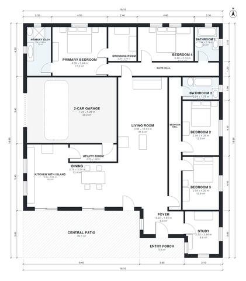

# 230 Square Meter House Plans: 4-Bed Single-Story Patio Villa

This is a single-storey villa of about 230 m² of living space, plus a 38 m² garage. It is arranged around a 40 m² patio on the northwest side. The open living, dining and kitchen area sits at the centre. The primary suite with dressing room is on the west side, three more bedrooms and two baths are spread around it, and the garage connects through the utility room. Some rooms and hallways are tight, and we can widen them on request.

| | |
|---|---|
| Levels | 1 |
| Footprint | 16.1 m × 18.9 m (53 ft × 62 ft) |
| Rooms | 17 indoor, 2 outdoor |
| Indoor area including garage, from the room grid | about 263 m² (2,829 sq ft) |

## Files here

- `area-schedule.csv` (room schedule)
- `building.json` (rooms, walls, openings as data)
- `plan-level1.dxf` (floor plan, DXF, drawing units: millimetres)

## More for this plan

- Plan page with the PDF plan set, IFC and 3D model, and a tool to change the plan: https://floorplan.ai-architectures.com/house-plans/230-square-meter-house-plans?utm_source=github-plans&utm_medium=probe&utm_campaign=github
- PDF plan set: https://storage.googleapis.com/20img/house-plans/230-square-meter-house-plans/plan-set.pdf
- IFC model: https://storage.googleapis.com/20img/house-plans/230-square-meter-house-plans/model.ifc

## Known issues in this drawing

- Foyer is 6.0 m² (asked for about 8.0 m²).
- Study is 8.6 m² (asked for about 12.0 m²).
- Living Room has no window.

Concept design generated with AI. Not for construction or permit; verify with a licensed professional.
