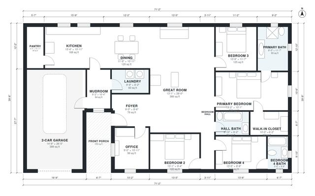

# 2300 Sq Ft House Plans: 4-Bed, 3-Bath Single-Story Design

This is a single-story, 4-bedroom, 3-bath home of roughly 2,300 sq ft of living space. The garage and front porch are extra. A large open kitchen, dining and great room sits in the middle. The primary suite with its bath and walk-in closet is at the east end, and the other three bedrooms and a hall bath are in a private bedroom wing. The mudroom and laundry sit between the 2-car garage and the kitchen, and the front office is off the foyer.

| | |
|---|---|
| Levels | 1 |
| Footprint | 21.7 m × 12.1 m (71 ft × 40 ft) |
| Rooms | 18 indoor, 1 outdoor |
| Indoor area including garage, from the room grid | about 253 m² (2,721 sq ft) |

## Files here

- `area-schedule.csv` (room schedule)
- `building.json` (rooms, walls, openings as data)
- `plan-level1.dxf` (floor plan, DXF, drawing units: inches)

## More for this plan

- Plan page with the PDF plan set, IFC and 3D model, and a tool to change the plan: https://floorplan.ai-architectures.com/house-plans/2300-sq-ft-house-plans?utm_source=github-plans&utm_medium=probe&utm_campaign=github
- PDF plan set: https://storage.googleapis.com/20img/house-plans/2300-sq-ft-house-plans/plan-set.pdf
- IFC model: https://storage.googleapis.com/20img/house-plans/2300-sq-ft-house-plans/model.ifc

## Known issues in this drawing

- None found by the automatic checks.

Concept design generated with AI. Not for construction or permit; verify with a licensed professional.
