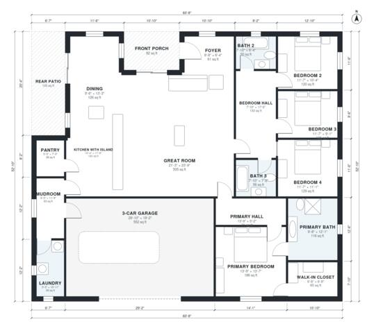

# 2400 Sq Ft 4 Bedroom House Plans: Single-Story, 3-Car Garage

This is a single-story, split-bedroom ranch of roughly 2,400 sq ft (about 223 m²) of living space. It has an open great room, island kitchen and dining area, a mudroom and laundry buffer to the 3-car garage, and a primary suite in its own wing. I'm trimming the oversized public rooms and garage so the bedrooms, foyer, baths and bedroom hall get more comfortable proportions.

| | |
|---|---|
| Levels | 1 |
| Footprint | 18.5 m × 16.1 m (61 ft × 53 ft) |
| Rooms | 18 indoor, 2 outdoor |
| Indoor area including garage, from the room grid | about 278 m² (2,991 sq ft) |

## Files here

- `area-schedule.csv` (room schedule)
- `building.json` (rooms, walls, openings as data)
- `plan-level1.dxf` (floor plan, DXF, drawing units: inches)

## More for this plan

- Plan page with the PDF plan set, IFC and 3D model, and a tool to change the plan: https://floorplan.ai-architectures.com/house-plans/2400-sq-ft-4-bedroom-house-plans?utm_source=github-plans&utm_medium=probe&utm_campaign=github
- PDF plan set: https://storage.googleapis.com/20img/house-plans/2400-sq-ft-4-bedroom-house-plans/plan-set.pdf
- IFC model: https://storage.googleapis.com/20img/house-plans/2400-sq-ft-4-bedroom-house-plans/model.ifc

## Known issues in this drawing

- Front Porch is not on the street side.
- Pantry is 3.5 m² (asked for about 5.0 m²).
- Foyer is 5.7 m² (asked for about 8.0 m²).

Concept design generated with AI. Not for construction or permit; verify with a licensed professional.
