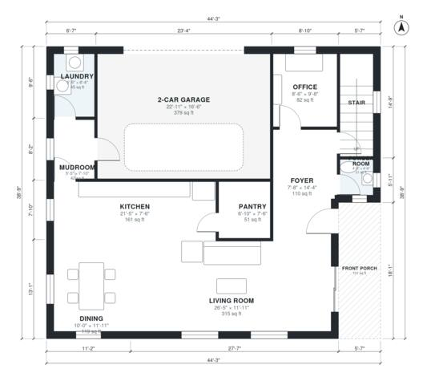

# 2400 Sq Ft House Plans: 2-Story, 4 Bed, 2.5 Bath Layout

A two-story modern farmhouse of about 213 m² (about 2,300 sq ft) of living space plus a 40 m² two-car garage. The ground floor has a front porch and foyer, an open kitchen, dining and living area with a pantry, an office, a powder room, and a mudroom and laundry beside the garage. Upstairs, three bedrooms and a hall bath open off one hall, and the primary suite with its own bath and walk-in closet sits at the end.

| | |
|---|---|
| Levels | 2 |
| Footprint | 13.5 m × 11.8 m (44 ft × 39 ft) |
| Rooms | 20 indoor, 2 outdoor |
| Indoor area including garage, from the room grid | about 253 m² (2,724 sq ft) |

## Files here

- `area-schedule.csv` (room schedule)
- `building.json` (rooms, walls, openings as data)
- `plan-level1.dxf` (floor plan, DXF, drawing units: inches)
- `plan-level2.dxf` (floor plan, DXF, drawing units: inches)

## More for this plan

- Plan page with the PDF plan set, IFC and 3D model, and a tool to change the plan: https://floorplan.ai-architectures.com/house-plans/2400-sq-ft-house-plans?utm_source=github-plans&utm_medium=probe&utm_campaign=github
- PDF plan set: https://storage.googleapis.com/20img/house-plans/2400-sq-ft-house-plans/plan-set.pdf
- IFC model: https://storage.googleapis.com/20img/house-plans/2400-sq-ft-house-plans/model.ifc

## Known issues in this drawing

- Mudroom is 3.9 m² (asked for about 6.0 m²).
- Office is 7.6 m² (asked for about 11.0 m²).
- Powder Room is 1.9 m² (asked for about 3.0 m²).

Concept design generated with AI. Not for construction or permit; verify with a licensed professional.
