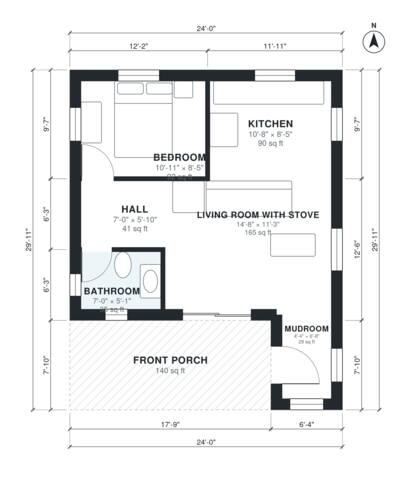

# 24x24 Cabin Floor Plans: 1 Bed, 1 Bath, 580 Sq Ft Layout

This is a compact one-bedroom, one-bath cabin of roughly 576 sq ft inside, with a covered front porch outside the square. The open kitchen and living room is centered on a wood stove, and a small mudroom corner at the entry takes the muddy boots. The bedroom and bath share a short hall off the living room, and every room gets daylight.

| | |
|---|---|
| Levels | 1 |
| Footprint | 7.32 m × 9.12 m (24 ft × 30 ft) |
| Rooms | 6 indoor, 1 outdoor |
| Indoor area including garage, from the room grid | about 54 m² (579 sq ft) |

## Files here

- `area-schedule.csv` (room schedule)
- `building.json` (rooms, walls, openings as data)
- `plan-level1.dxf` (floor plan, DXF, drawing units: inches)

## More for this plan

- Plan page with the PDF plan set, IFC and 3D model, and a tool to change the plan: https://floorplan.ai-architectures.com/house-plans/24x24-cabin-floor-plans?utm_source=github-plans&utm_medium=probe&utm_campaign=github
- PDF plan set: https://storage.googleapis.com/20img/house-plans/24x24-cabin-floor-plans/plan-set.pdf
- IFC model: https://storage.googleapis.com/20img/house-plans/24x24-cabin-floor-plans/model.ifc

## Known issues in this drawing

- Mudroom is 2.7 m² (asked for about 4.5 m²).

Concept design generated with AI. Not for construction or permit; verify with a licensed professional.
