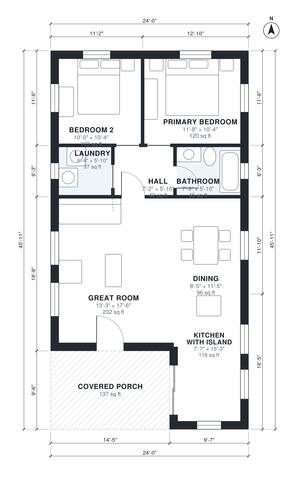

# 24x40 Barndominium Floor Plans: 2 Bed, 1 Bath, 970 Sq Ft

This is a 24 x 40 ft single-storey barndominium with about 960 sq ft of living space, plus a covered porch at the front. An open great room, kitchen with island and dining area takes up the front and middle of the house. Two bedrooms, a shared bath and the laundry sit behind it, off a short hall.

| | |
|---|---|
| Levels | 1 |
| Footprint | 7.32 m × 14.0 m (24 ft × 46 ft) |
| Rooms | 8 indoor, 1 outdoor |
| Indoor area including garage, from the room grid | about 90 m² (966 sq ft) |

## Files here

- `area-schedule.csv` (room schedule)
- `building.json` (rooms, walls, openings as data)
- `plan-level1.dxf` (floor plan, DXF, drawing units: inches)

## More for this plan

- Plan page with the PDF plan set, IFC and 3D model, and a tool to change the plan: https://floorplan.ai-architectures.com/house-plans/24x40-barndominium-floor-plans?utm_source=github-plans&utm_medium=probe&utm_campaign=github
- PDF plan set: https://storage.googleapis.com/20img/house-plans/24x40-barndominium-floor-plans/plan-set.pdf
- IFC model: https://storage.googleapis.com/20img/house-plans/24x40-barndominium-floor-plans/model.ifc

## Known issues in this drawing

- Dining is only 2.56 m wide.

Concept design generated with AI. Not for construction or permit; verify with a licensed professional.
