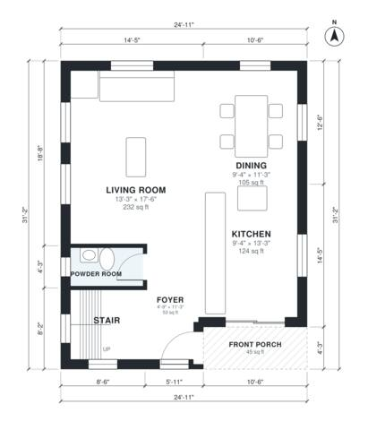

# 25 Ft Wide House Plans: 3-Bed Two-Story, 1,510 Sq Ft

This is a 25 ft wide, two-story infill home of roughly 1,500 sq ft. The ground floor has an open kitchen, dining and living area, a powder room and a front porch. Upstairs are three bedrooms, two baths and a laundry off a central hall. I'm adjusting room sizes and minimum widths so Bedroom 3, the hall and the laundry come out with usable proportions.

| | |
|---|---|
| Levels | 2 |
| Footprint | 7.6 m × 9.5 m (25 ft × 31 ft) |
| Rooms | 14 indoor, 1 outdoor |
| Indoor area including garage, from the room grid | about 140 m² (1,510 sq ft) |

## Files here

- `area-schedule.csv` (room schedule)
- `building.json` (rooms, walls, openings as data)
- `plan-level1.dxf` (floor plan, DXF, drawing units: inches)
- `plan-level2.dxf` (floor plan, DXF, drawing units: inches)

## More for this plan

- Plan page with the PDF plan set, IFC and 3D model, and a tool to change the plan: https://floorplan.ai-architectures.com/house-plans/25-ft-wide-house-plans?utm_source=github-plans&utm_medium=probe&utm_campaign=github
- PDF plan set: https://storage.googleapis.com/20img/house-plans/25-ft-wide-house-plans/plan-set.pdf
- IFC model: https://storage.googleapis.com/20img/house-plans/25-ft-wide-house-plans/model.ifc

## Known issues in this drawing

- Bedroom 2 is only 2.24 m wide.

Concept design generated with AI. Not for construction or permit; verify with a licensed professional.
