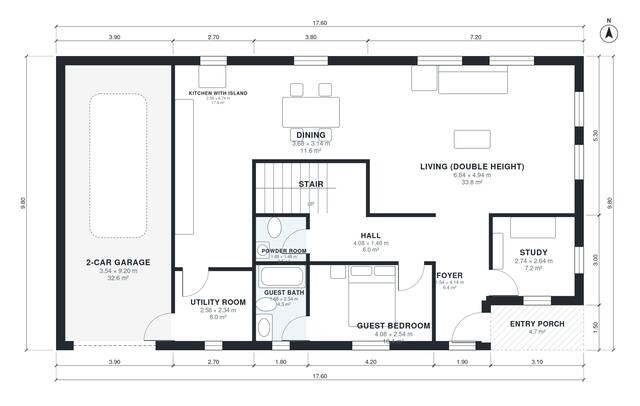

# 250 Square Meter House Plans: 5-Bed, 2-Story Home | 2,560 Sq Ft

A two-storey, 5-bedroom, 4-bath house of about 250 m² of living space (garage excluded) on a compact 16 x 11 m footprint. The ground floor has an open kitchen, dining and double-height living room, a study, a guest bedroom with bath, a powder room and a utility room that opens to the attached 2-car garage. Upstairs, the primary suite with dressing room and bath, three more bedrooms and a shared bath all open off one landing hall.

| | |
|---|---|
| Levels | 2 |
| Footprint | 17.6 m × 9.8 m (58 ft × 32 ft) |
| Rooms | 21 indoor, 2 outdoor |
| Indoor area including garage, from the room grid | about 276 m² (2,967 sq ft) |

## Files here

- `area-schedule.csv` (room schedule)
- `building.json` (rooms, walls, openings as data)
- `plan-level1.dxf` (floor plan, DXF, drawing units: millimetres)
- `plan-level2.dxf` (floor plan, DXF, drawing units: millimetres)

## More for this plan

- Plan page with the PDF plan set, IFC and 3D model, and a tool to change the plan: https://floorplan.ai-architectures.com/house-plans/250-square-meter-house-plans?utm_source=github-plans&utm_medium=probe&utm_campaign=github
- PDF plan set: https://storage.googleapis.com/20img/house-plans/250-square-meter-house-plans/plan-set.pdf
- IFC model: https://storage.googleapis.com/20img/house-plans/250-square-meter-house-plans/model.ifc

## Known issues in this drawing

- Guest Bedroom is only 2.54 m wide.
- Study is 7.2 m² (asked for about 10.0 m²).

Concept design generated with AI. Not for construction or permit; verify with a licensed professional.
