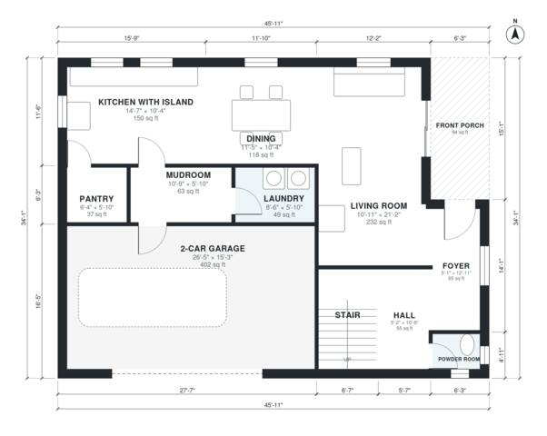

# 2500 Sq Ft 4 Bedroom House Plans: 2,590 Sq Ft Two-Story Plan

A two-story modern farmhouse of about 290 m² gross, with the 40 m² garage on the ground floor and roughly 250 m² (about 2,700 sq ft) of living space. The ground floor has an open kitchen with island, dining and living area, a pantry, a mudroom and laundry off the 2-car garage, a powder room and a front porch. Upstairs are four bedrooms, a primary suite with bath and walk-in closet, two more full baths and a bonus room.

| | |
|---|---|
| Levels | 2 |
| Footprint | 14.0 m × 10.4 m (46 ft × 34 ft) |
| Rooms | 22 indoor, 1 outdoor |
| Indoor area including garage, from the room grid | about 282 m² (3,040 sq ft) |

## Files here

- `area-schedule.csv` (room schedule)
- `building.json` (rooms, walls, openings as data)
- `plan-level1.dxf` (floor plan, DXF, drawing units: inches)
- `plan-level2.dxf` (floor plan, DXF, drawing units: inches)

## More for this plan

- Plan page with the PDF plan set, IFC and 3D model, and a tool to change the plan: https://floorplan.ai-architectures.com/house-plans/2500-sq-ft-4-bedroom-house-plans?utm_source=github-plans&utm_medium=probe&utm_campaign=github
- PDF plan set: https://storage.googleapis.com/20img/house-plans/2500-sq-ft-4-bedroom-house-plans/plan-set.pdf
- IFC model: https://storage.googleapis.com/20img/house-plans/2500-sq-ft-4-bedroom-house-plans/model.ifc

## Known issues in this drawing

- Front Porch is not on the street side.
- Powder Room is 1.8 m² (asked for about 3.0 m²).
- Walk-in Closet is 5.0 m² (asked for about 7.0 m²).
- Bedroom 2 is 10.5 m² (asked for about 14.0 m²).

Concept design generated with AI. Not for construction or permit; verify with a licensed professional.
