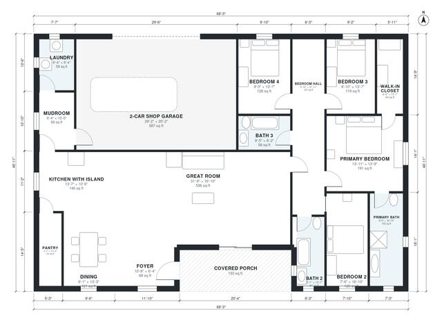

# 2500 Sq Ft Barndominium Floor Plans | 4 Bed, 3 Bath, Shop

This single-story barndominium has about 230 m² (2,480 sq ft) of living space, plus a 58 m² two-car shop garage. The great room, island kitchen and dining area form one open space. The primary suite is at one end, and three bedrooms and two baths open off a hall. The mudroom, laundry and pantry sit between the kitchen and the shop, and a covered porch leads into the foyer.

| | |
|---|---|
| Levels | 1 |
| Footprint | 20.8 m × 14.3 m (68 ft × 47 ft) |
| Rooms | 17 indoor, 1 outdoor |
| Indoor area including garage, from the room grid | about 283 m² (3,048 sq ft) |

## Files here

- `area-schedule.csv` (room schedule)
- `building.json` (rooms, walls, openings as data)
- `plan-level1.dxf` (floor plan, DXF, drawing units: inches)

## More for this plan

- Plan page with the PDF plan set, IFC and 3D model, and a tool to change the plan: https://floorplan.ai-architectures.com/house-plans/2500-sq-ft-barndominium-floor-plans?utm_source=github-plans&utm_medium=probe&utm_campaign=github
- PDF plan set: https://storage.googleapis.com/20img/house-plans/2500-sq-ft-barndominium-floor-plans/plan-set.pdf
- IFC model: https://storage.googleapis.com/20img/house-plans/2500-sq-ft-barndominium-floor-plans/model.ifc

## Known issues in this drawing

- Bedroom 2 is only 2.28 m wide.

Concept design generated with AI. Not for construction or permit; verify with a licensed professional.
