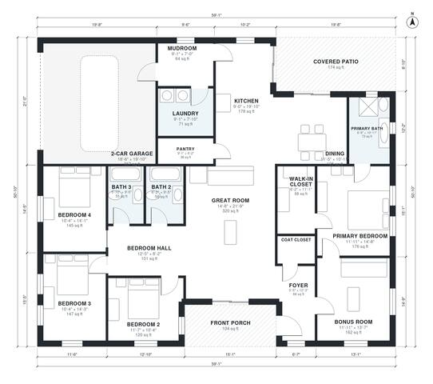

# 2500 Sq Ft House Plans: 4-Bed Single-Story with Bonus Room

This is a single-story home of about 2,500 sq ft of living area. It has an open great room, kitchen and dining at the center. The primary suite is in its own wing, three more bedrooms share a hall with two baths, and a mudroom with laundry connects the 2-car garage to the kitchen. The revision gives the bonus room real walls and a window, and moves the walk-in closet back to the primary bedroom. It also adds width to the bedrooms and dining.

| | |
|---|---|
| Levels | 1 |
| Footprint | 18.0 m × 15.5 m (59 ft × 51 ft) |
| Rooms | 19 indoor, 2 outdoor |
| Indoor area including garage, from the room grid | about 253 m² (2,725 sq ft) |

## Files here

- `area-schedule.csv` (room schedule)
- `building.json` (rooms, walls, openings as data)
- `plan-level1.dxf` (floor plan, DXF, drawing units: inches)

## More for this plan

- Plan page with the PDF plan set, IFC and 3D model, and a tool to change the plan: https://floorplan.ai-architectures.com/house-plans/2500-sq-ft-house-plans?utm_source=github-plans&utm_medium=probe&utm_campaign=github
- PDF plan set: https://storage.googleapis.com/20img/house-plans/2500-sq-ft-house-plans/plan-set.pdf
- IFC model: https://storage.googleapis.com/20img/house-plans/2500-sq-ft-house-plans/model.ifc

## Known issues in this drawing

- Bedroom Hall and Primary Bedroom are not directly connected.

Concept design generated with AI. Not for construction or permit; verify with a licensed professional.
