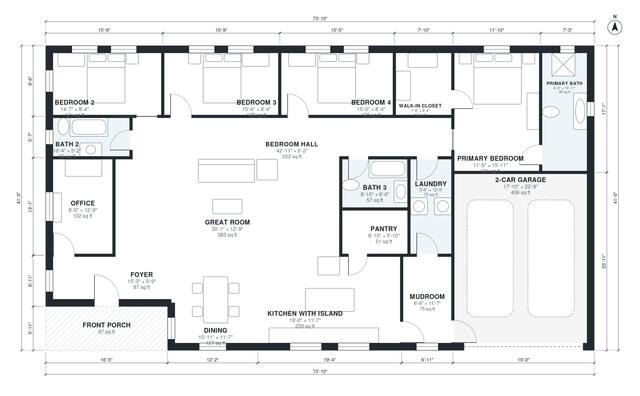

# 2500 Sq Ft Modern Farmhouse Plans: 4 Bed, 3 Bath One-Story

A single-story modern farmhouse with about 231 m² (2,500 sq ft) of living space, plus a 40 m² 2-car garage and a front porch. It has an open great room, island kitchen and dining area, a mudroom between the garage and laundry, and a primary suite with an ensuite and walk-in closet. The revision makes the bedroom hall a proper corridor and widens the narrow rooms.

| | |
|---|---|
| Levels | 1 |
| Footprint | 22.5 m × 12.5 m (74 ft × 41 ft) |
| Rooms | 18 indoor, 1 outdoor |
| Indoor area including garage, from the room grid | about 272 m² (2,930 sq ft) |

## Files here

- `area-schedule.csv` (room schedule)
- `building.json` (rooms, walls, openings as data)
- `plan-level1.dxf` (floor plan, DXF, drawing units: inches)

## More for this plan

- Plan page with the PDF plan set, IFC and 3D model, and a tool to change the plan: https://floorplan.ai-architectures.com/house-plans/2500-sq-ft-modern-farmhouse-plans?utm_source=github-plans&utm_medium=probe&utm_campaign=github
- PDF plan set: https://storage.googleapis.com/20img/house-plans/2500-sq-ft-modern-farmhouse-plans/plan-set.pdf
- IFC model: https://storage.googleapis.com/20img/house-plans/2500-sq-ft-modern-farmhouse-plans/model.ifc

## Known issues in this drawing

- Great Room has no window.

Concept design generated with AI. Not for construction or permit; verify with a licensed professional.
