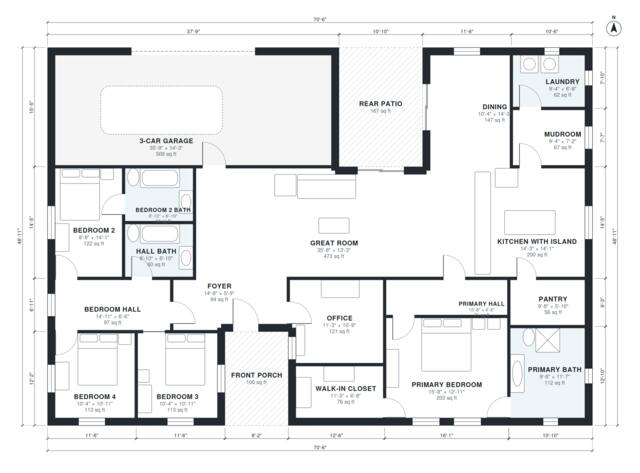

# 2600 Sq Ft 4 Bedroom House Plans: Single-Story Split Layout

A single-storey, split-plan home of about 241 m² (2,600 sq ft) of living space, plus a 3-car garage, porch and rear patio. The primary suite is in its own west wing, and three bedrooms are in the east wing. The open kitchen with island and pantry, the dining area and the great room face a rear patio, with an office at the front and a mudroom between the kitchen and garage.

| | |
|---|---|
| Levels | 1 |
| Footprint | 21.5 m × 14.9 m (71 ft × 49 ft) |
| Rooms | 19 indoor, 2 outdoor |
| Indoor area including garage, from the room grid | about 296 m² (3,182 sq ft) |

## Files here

- `area-schedule.csv` (room schedule)
- `building.json` (rooms, walls, openings as data)
- `plan-level1.dxf` (floor plan, DXF, drawing units: inches)

## More for this plan

- Plan page with the PDF plan set, IFC and 3D model, and a tool to change the plan: https://floorplan.ai-architectures.com/house-plans/2600-sq-ft-4-bedroom-house-plans?utm_source=github-plans&utm_medium=probe&utm_campaign=github
- PDF plan set: https://storage.googleapis.com/20img/house-plans/2600-sq-ft-4-bedroom-house-plans/plan-set.pdf
- IFC model: https://storage.googleapis.com/20img/house-plans/2600-sq-ft-4-bedroom-house-plans/model.ifc

## Known issues in this drawing

- Mudroom and 3-Car Garage are not directly connected.

Concept design generated with AI. Not for construction or permit; verify with a licensed professional.
