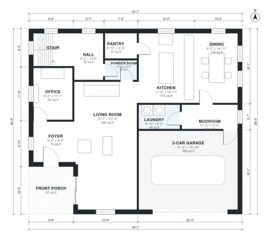

# 2600 Sq Ft House Plans: 4 Bed Two-Story with Office & Garage

This is a two-story modern farmhouse of roughly 2,600 sq ft of living space plus a 2-car garage. The ground floor has an open kitchen, dining and living area, an office, a mudroom and laundry, a pantry, a powder room and a front porch. Upstairs are the primary suite with a walk-in closet and bath, three more bedrooms and a hall bath. The revision removes the unrequested loft, widens the bedrooms and bathrooms, and gives the primary bath and powder room more room.

| | |
|---|---|
| Levels | 2 |
| Footprint | 13.9 m × 12.1 m (46 ft × 40 ft) |
| Rooms | 22 indoor, 2 outdoor |
| Indoor area including garage, from the room grid | about 285 m² (3,069 sq ft) |

## Files here

- `area-schedule.csv` (room schedule)
- `building.json` (rooms, walls, openings as data)
- `plan-level1.dxf` (floor plan, DXF, drawing units: inches)
- `plan-level2.dxf` (floor plan, DXF, drawing units: inches)

## More for this plan

- Plan page with the PDF plan set, IFC and 3D model, and a tool to change the plan: https://floorplan.ai-architectures.com/house-plans/2600-sq-ft-house-plans?utm_source=github-plans&utm_medium=probe&utm_campaign=github
- PDF plan set: https://storage.googleapis.com/20img/house-plans/2600-sq-ft-house-plans/plan-set.pdf
- IFC model: https://storage.googleapis.com/20img/house-plans/2600-sq-ft-house-plans/model.ifc

## Known issues in this drawing

- Foyer and Hall are not directly connected.
- Bedroom 3 is only 2.14 m wide.
- Bedroom 2 is only 2.14 m wide.

Concept design generated with AI. Not for construction or permit; verify with a licensed professional.
