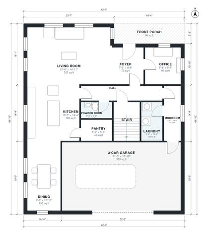

# 2700 Sq Ft House Plans: 4-Bed Two-Story with 3-Car Garage

This is a two-story, 4-bedroom, 3.5-bath modern farmhouse with about 240 m² (roughly 2,600 sq ft) of living space, not counting the 3-car garage. Downstairs has an open living, kitchen and dining area, an office off the foyer, a pantry, a powder room, and a mudroom with laundry that connects to the garage. Upstairs has a primary suite with a bath and walk-in closet, three more bedrooms, and two more baths off a central hall.

| | |
|---|---|
| Levels | 2 |
| Footprint | 12.8 m × 15.2 m (42 ft × 50 ft) |
| Rooms | 22 indoor, 2 outdoor |
| Indoor area including garage, from the room grid | about 306 m² (3,293 sq ft) |

## Files here

- `area-schedule.csv` (room schedule)
- `building.json` (rooms, walls, openings as data)
- `plan-level1.dxf` (floor plan, DXF, drawing units: inches)
- `plan-level2.dxf` (floor plan, DXF, drawing units: inches)

## More for this plan

- Plan page with the PDF plan set, IFC and 3D model, and a tool to change the plan: https://floorplan.ai-architectures.com/house-plans/2700-sq-ft-house-plans?utm_source=github-plans&utm_medium=probe&utm_campaign=github
- PDF plan set: https://storage.googleapis.com/20img/house-plans/2700-sq-ft-house-plans/plan-set.pdf
- IFC model: https://storage.googleapis.com/20img/house-plans/2700-sq-ft-house-plans/model.ifc

## Known issues in this drawing

- Front Porch is not on the street side.

Concept design generated with AI. Not for construction or permit; verify with a licensed professional.
