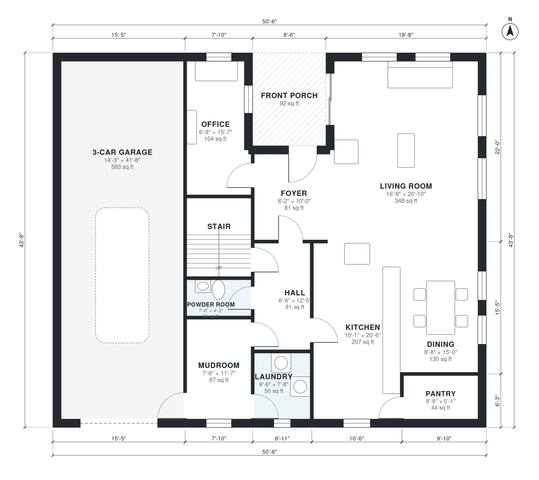

# 2800 Sq Ft House Plans: 4-Bed Two-Story with 3-Car Garage

This is a two-story modern farmhouse of about 2,770 sq ft of living space, not counting the 3-car garage or the front porch. The ground floor has an open kitchen, dining and living area, an office, a pantry, a powder room, a mudroom with a laundry room, and a garage entry. Upstairs, the primary suite has its own bath and walk-in closet. Bedroom 2 has an ensuite, and Bedrooms 3 and 4 share a hall bath.

| | |
|---|---|
| Levels | 2 |
| Footprint | 15.4 m × 13.3 m (51 ft × 44 ft) |
| Rooms | 22 indoor, 2 outdoor |
| Indoor area including garage, from the room grid | about 323 m² (3,472 sq ft) |

## Files here

- `area-schedule.csv` (room schedule)
- `building.json` (rooms, walls, openings as data)
- `plan-level1.dxf` (floor plan, DXF, drawing units: inches)
- `plan-level2.dxf` (floor plan, DXF, drawing units: inches)

## More for this plan

- Plan page with the PDF plan set, IFC and 3D model, and a tool to change the plan: https://floorplan.ai-architectures.com/house-plans/2800-sq-ft-house-plans?utm_source=github-plans&utm_medium=probe&utm_campaign=github
- PDF plan set: https://storage.googleapis.com/20img/house-plans/2800-sq-ft-house-plans/plan-set.pdf
- IFC model: https://storage.googleapis.com/20img/house-plans/2800-sq-ft-house-plans/model.ifc

## Known issues in this drawing

- Front Porch is not on the street side.

Concept design generated with AI. Not for construction or permit; verify with a licensed professional.
