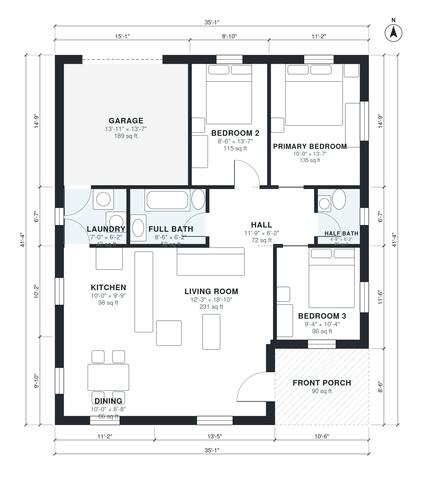

# 3 Bedroom 1.5 Bath House Plans: 1,140 Sq Ft Single-Story

This is a single-story ranch of about 1,300 sq ft of living space. It has three bedrooms, a full bath and a half bath, and a large open kitchen, living and dining area. A front porch leads into the living room, and the attached 1-car garage connects through the laundry. The bedrooms are grouped off a central hall away from the main living space, which keeps them private.

| | |
|---|---|
| Levels | 1 |
| Footprint | 10.7 m × 12.6 m (35 ft × 41 ft) |
| Rooms | 11 indoor, 1 outdoor |
| Indoor area including garage, from the room grid | about 126 m² (1,362 sq ft) |

## Files here

- `area-schedule.csv` (room schedule)
- `building.json` (rooms, walls, openings as data)
- `plan-level1.dxf` (floor plan, DXF, drawing units: inches)

## More for this plan

- Plan page with the PDF plan set, IFC and 3D model, and a tool to change the plan: https://floorplan.ai-architectures.com/house-plans/3-bedroom-1-5-bath-house-plans?utm_source=github-plans&utm_medium=probe&utm_campaign=github
- PDF plan set: https://storage.googleapis.com/20img/house-plans/3-bedroom-1-5-bath-house-plans/plan-set.pdf
- IFC model: https://storage.googleapis.com/20img/house-plans/3-bedroom-1-5-bath-house-plans/model.ifc

## Known issues in this drawing

- None found by the automatic checks.

Concept design generated with AI. Not for construction or permit; verify with a licensed professional.
