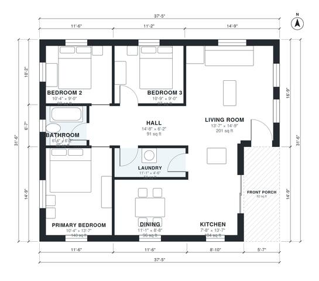

# 3 Bedroom 1 Bath House Plans: 1,100 Sq Ft Single Story

This is a compact single-story ranch of about 1,100 sq ft (about 102 m²) plus an 8 m² front porch. You enter from the porch into an open living, kitchen and dining space. A central hall leads to three bedrooms, a shared bath and the laundry.

| | |
|---|---|
| Levels | 1 |
| Footprint | 11.4 m × 9.6 m (37 ft × 31 ft) |
| Rooms | 9 indoor, 1 outdoor |
| Indoor area including garage, from the room grid | about 102 m² (1,096 sq ft) |

## Files here

- `area-schedule.csv` (room schedule)
- `building.json` (rooms, walls, openings as data)
- `plan-level1.dxf` (floor plan, DXF, drawing units: inches)

## More for this plan

- Plan page with the PDF plan set, IFC and 3D model, and a tool to change the plan: https://floorplan.ai-architectures.com/house-plans/3-bedroom-1-bath-house-plans?utm_source=github-plans&utm_medium=probe&utm_campaign=github
- PDF plan set: https://storage.googleapis.com/20img/house-plans/3-bedroom-1-bath-house-plans/plan-set.pdf
- IFC model: https://storage.googleapis.com/20img/house-plans/3-bedroom-1-bath-house-plans/model.ifc

## Known issues in this drawing

- Bathroom is 3.6 m² (asked for about 5.5 m²).

Concept design generated with AI. Not for construction or permit; verify with a licensed professional.
