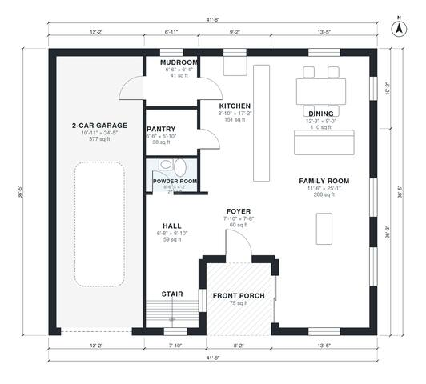

# 3 Bedroom 2.5 Bath House Plans: 2,080 Sq Ft Two-Story Plan

This is a two-story, 3-bedroom, 2.5-bath modern farmhouse of about 195 m² (2,100 sq ft) of living space, plus a 2-car garage and a front porch. The ground floor has an open kitchen, dining and family room, a powder room and a mudroom off the garage. Upstairs are the primary suite with a walk-in closet, two bedrooms, a hall bath and the laundry. The revision merges the small hall into the foyer, drops the separate pantry and gives the powder room and dining room more usable proportions.

| | |
|---|---|
| Levels | 2 |
| Footprint | 12.7 m × 11.1 m (42 ft × 36 ft) |
| Rooms | 19 indoor, 2 outdoor |
| Indoor area including garage, from the room grid | about 234 m² (2,517 sq ft) |

## Files here

- `area-schedule.csv` (room schedule)
- `building.json` (rooms, walls, openings as data)
- `plan-level1.dxf` (floor plan, DXF, drawing units: inches)
- `plan-level2.dxf` (floor plan, DXF, drawing units: inches)

## More for this plan

- Plan page with the PDF plan set, IFC and 3D model, and a tool to change the plan: https://floorplan.ai-architectures.com/house-plans/3-bedroom-2-5-bath-house-plans?utm_source=github-plans&utm_medium=probe&utm_campaign=github
- PDF plan set: https://storage.googleapis.com/20img/house-plans/3-bedroom-2-5-bath-house-plans/plan-set.pdf
- IFC model: https://storage.googleapis.com/20img/house-plans/3-bedroom-2-5-bath-house-plans/model.ifc

## Known issues in this drawing

- Bedroom 3 is only 2.04 m wide.

Concept design generated with AI. Not for construction or permit; verify with a licensed professional.
