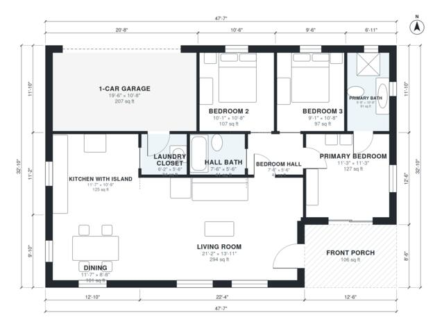

# 3 Bedroom 2 Bath Barndominium Floor Plans | 1,210 Sq Ft Plan

This is a compact single-story barndominium of roughly 47'-7" x 32'-10", with about 1,450 sq ft of living space plus a 1-car garage and a covered front porch. The kitchen with island, dining and living room share one open area at the front, and the three bedrooms and two baths sit off a short central hall. The garage connects through the laundry closet.

| | |
|---|---|
| Levels | 1 |
| Footprint | 14.5 m × 10.0 m (48 ft × 33 ft) |
| Rooms | 11 indoor, 1 outdoor |
| Indoor area including garage, from the room grid | about 135 m² (1,454 sq ft) |

## Files here

- `area-schedule.csv` (room schedule)
- `building.json` (rooms, walls, openings as data)
- `plan-level1.dxf` (floor plan, DXF, drawing units: inches)

## More for this plan

- Plan page with the PDF plan set, IFC and 3D model, and a tool to change the plan: https://floorplan.ai-architectures.com/house-plans/3-bedroom-2-bath-barndominium-floor-plans?utm_source=github-plans&utm_medium=probe&utm_campaign=github
- PDF plan set: https://storage.googleapis.com/20img/house-plans/3-bedroom-2-bath-barndominium-floor-plans/plan-set.pdf
- IFC model: https://storage.googleapis.com/20img/house-plans/3-bedroom-2-bath-barndominium-floor-plans/model.ifc

## Known issues in this drawing

- None found by the automatic checks.

Concept design generated with AI. Not for construction or permit; verify with a licensed professional.
