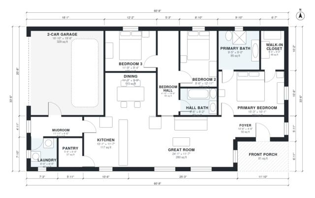

# 3 Bedroom 2 Bath House Plans: 1,580 Sq Ft Single-Story

This is a single-story, 3-bedroom, 2-bath split-plan home of about 144 m² (1,550 sq ft) of living space, plus a 2-car garage and front porch. The primary suite with bath and walk-in closet is on one side of a large open kitchen, dining and great room. Two bedrooms and a hall bath are on the other side, and the garage enters through a mudroom and laundry.

| | |
|---|---|
| Levels | 1 |
| Footprint | 18.5 m × 10.2 m (61 ft × 33 ft) |
| Rooms | 15 indoor, 1 outdoor |
| Indoor area including garage, from the room grid | about 181 m² (1,950 sq ft) |

## Files here

- `area-schedule.csv` (room schedule)
- `building.json` (rooms, walls, openings as data)
- `plan-level1.dxf` (floor plan, DXF, drawing units: inches)

## More for this plan

- Plan page with the PDF plan set, IFC and 3D model, and a tool to change the plan: https://floorplan.ai-architectures.com/house-plans/3-bedroom-2-bath-house-plans?utm_source=github-plans&utm_medium=probe&utm_campaign=github
- PDF plan set: https://storage.googleapis.com/20img/house-plans/3-bedroom-2-bath-house-plans/plan-set.pdf
- IFC model: https://storage.googleapis.com/20img/house-plans/3-bedroom-2-bath-house-plans/model.ifc

## Known issues in this drawing

- Dining has no window.

Concept design generated with AI. Not for construction or permit; verify with a licensed professional.
