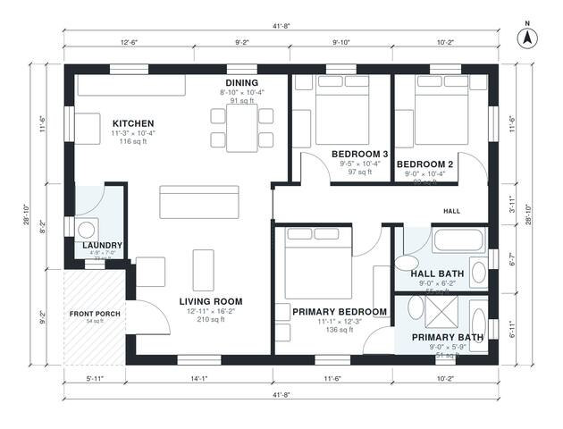

# 3 Bedroom ADU Plans: 1,150 Sq Ft Detached Single-Level Home

This is a single-storey detached ADU of about 1,150 sq ft (about 107 m²) with a small covered front porch. The kitchen, dining and living areas share one open space at the front and left. A central hall serves three bedrooms and a hall bath, and the primary bedroom has its own ensuite. The laundry is a compact room off the kitchen. The laundry and primary bath are slightly smaller than requested, and both could be enlarged if you prefer.

| | |
|---|---|
| Levels | 1 |
| Footprint | 12.7 m × 8.8 m (42 ft × 29 ft) |
| Rooms | 10 indoor, 1 outdoor |
| Indoor area including garage, from the room grid | about 107 m² (1,149 sq ft) |

## Files here

- `area-schedule.csv` (room schedule)
- `building.json` (rooms, walls, openings as data)
- `plan-level1.dxf` (floor plan, DXF, drawing units: inches)

## More for this plan

- Plan page with the PDF plan set, IFC and 3D model, and a tool to change the plan: https://floorplan.ai-architectures.com/house-plans/3-bedroom-adu-plans?utm_source=github-plans&utm_medium=probe&utm_campaign=github
- PDF plan set: https://storage.googleapis.com/20img/house-plans/3-bedroom-adu-plans/plan-set.pdf
- IFC model: https://storage.googleapis.com/20img/house-plans/3-bedroom-adu-plans/model.ifc

## Known issues in this drawing

- Laundry is 3.1 m² (asked for about 4.5 m²).

Concept design generated with AI. Not for construction or permit; verify with a licensed professional.
