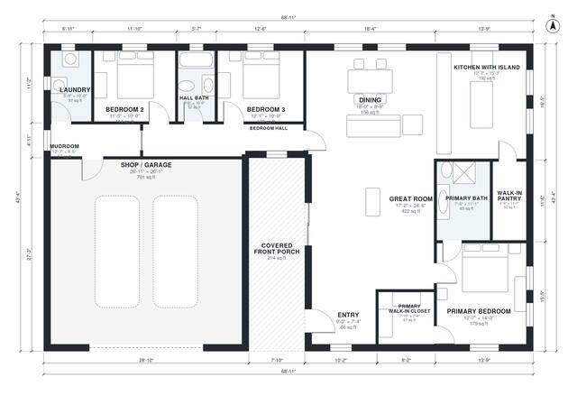

# 3 Bedroom Barndominium Floor Plans: 1,980 Sq Ft Single Story

A single-story barndominium of roughly 21 x 13.2 m with about 1,850 sq ft of heated living space, plus a large attached shop/garage and a covered front porch. The open great room, kitchen with island, dining area and walk-in pantry sit on the right. The primary suite is on the far side, two bedrooms share a hall bath, and the mudroom and laundry link the home to the shop.

| | |
|---|---|
| Levels | 1 |
| Footprint | 21.0 m × 13.2 m (69 ft × 43 ft) |
| Rooms | 15 indoor, 1 outdoor |
| Indoor area including garage, from the room grid | about 257 m² (2,769 sq ft) |

## Files here

- `area-schedule.csv` (room schedule)
- `building.json` (rooms, walls, openings as data)
- `plan-level1.dxf` (floor plan, DXF, drawing units: inches)

## More for this plan

- Plan page with the PDF plan set, IFC and 3D model, and a tool to change the plan: https://floorplan.ai-architectures.com/house-plans/3-bedroom-barndominium-floor-plans?utm_source=github-plans&utm_medium=probe&utm_campaign=github
- PDF plan set: https://storage.googleapis.com/20img/house-plans/3-bedroom-barndominium-floor-plans/plan-set.pdf
- IFC model: https://storage.googleapis.com/20img/house-plans/3-bedroom-barndominium-floor-plans/model.ifc

## Known issues in this drawing

- Dining is only 2.64 m wide.

Concept design generated with AI. Not for construction or permit; verify with a licensed professional.
