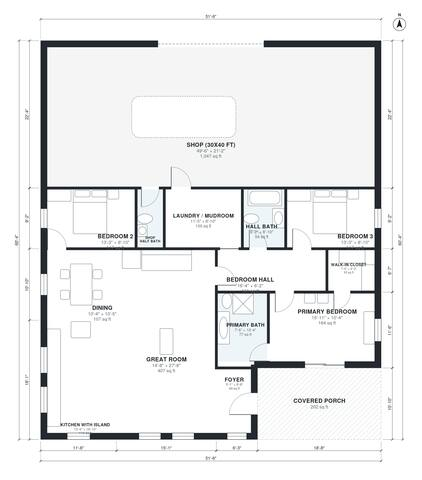

# 3 Bedroom Barndominium With Shop House Plan | 1,760 Sq Ft

This is a single-level metal-clad barndominium of about 295 m² (3,170 sq ft) under roof. It has roughly 167 m² (1,800 sq ft) of living space, a 30x40 ft shop and a covered porch. It has an open great room, kitchen with island and dining area, and a bedroom wing with a primary suite plus two bedrooms and a hall bath. The laundry/mudroom sits between the house and the shop. The revision makes the footprint deeper so the shop can be a true 30x40 ft and the great room is wider and brighter.

| | |
|---|---|
| Levels | 1 |
| Footprint | 15.7 m × 18.4 m (52 ft × 60 ft) |
| Rooms | 14 indoor, 1 outdoor |
| Indoor area including garage, from the room grid | about 270 m² (2,907 sq ft) |

## Files here

- `area-schedule.csv` (room schedule)
- `building.json` (rooms, walls, openings as data)
- `plan-level1.dxf` (floor plan, DXF, drawing units: inches)

## More for this plan

- Plan page with the PDF plan set, IFC and 3D model, and a tool to change the plan: https://floorplan.ai-architectures.com/house-plans/3-bedroom-barndominium-with-shop?utm_source=github-plans&utm_medium=probe&utm_campaign=github
- PDF plan set: https://storage.googleapis.com/20img/house-plans/3-bedroom-barndominium-with-shop/plan-set.pdf
- IFC model: https://storage.googleapis.com/20img/house-plans/3-bedroom-barndominium-with-shop/model.ifc

## Known issues in this drawing

- Bedroom Hall and Bedroom 2 are not directly connected.

Concept design generated with AI. Not for construction or permit; verify with a licensed professional.
