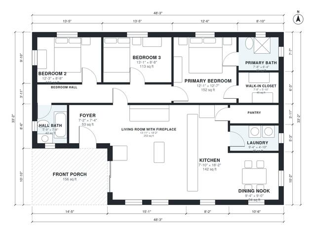

# 3 Bedroom Bungalow House Plans: 1,440 Sq Ft, 2 Bath, Porch

This is a single-story craftsman bungalow with about 134 m² (1,450 sq ft) of indoor living space, plus a deep front porch. You enter through the porch into a foyer and a front living room with a fireplace. The kitchen, dining nook, pantry and laundry sit behind the living room. A short hall at the back serves two bedrooms, a hall bath and a primary suite with its own bath and walk-in closet.

| | |
|---|---|
| Levels | 1 |
| Footprint | 14.7 m × 10.1 m (48 ft × 33 ft) |
| Rooms | 13 indoor, 1 outdoor |
| Indoor area including garage, from the room grid | about 134 m² (1,442 sq ft) |

## Files here

- `area-schedule.csv` (room schedule)
- `building.json` (rooms, walls, openings as data)
- `plan-level1.dxf` (floor plan, DXF, drawing units: inches)

## More for this plan

- Plan page with the PDF plan set, IFC and 3D model, and a tool to change the plan: https://floorplan.ai-architectures.com/house-plans/3-bedroom-bungalow-house-plans?utm_source=github-plans&utm_medium=probe&utm_campaign=github
- PDF plan set: https://storage.googleapis.com/20img/house-plans/3-bedroom-bungalow-house-plans/plan-set.pdf
- IFC model: https://storage.googleapis.com/20img/house-plans/3-bedroom-bungalow-house-plans/model.ifc

## Known issues in this drawing

- Hall Bath is 3.9 m² (asked for about 5.5 m²).

Concept design generated with AI. Not for construction or permit; verify with a licensed professional.
