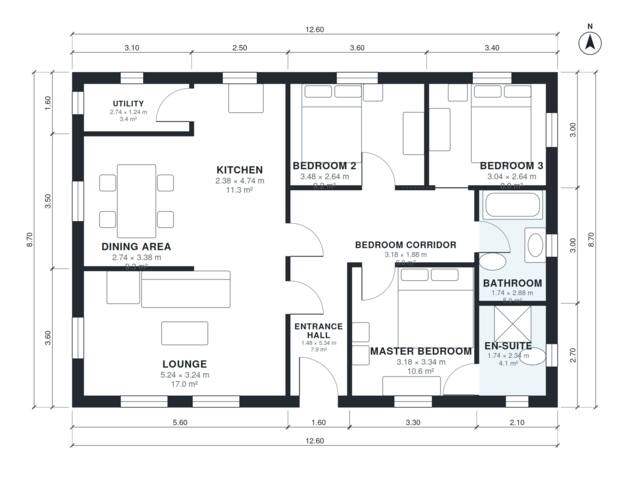

# 3 Bedroom Bungalow Plans UK: 1,180 Sq Ft Single-Story Home

This is a single-storey, three-bedroom bungalow of about 110 m² (1,184 sq ft), excluding the garage. A central entrance hall leads to a separate lounge, an open kitchen-diner with a utility off it, and a bedroom corridor. The master bedroom has an en-suite, and the other two bedrooms share a family bathroom.

| | |
|---|---|
| Levels | 1 |
| Footprint | 12.6 m × 8.7 m (41 ft × 29 ft) |
| Rooms | 11 indoor, 0 outdoor |
| Indoor area including garage, from the room grid | about 110 m² (1,180 sq ft) |

## Files here

- `area-schedule.csv` (room schedule)
- `building.json` (rooms, walls, openings as data)
- `plan-level1.dxf` (floor plan, DXF, drawing units: millimetres)

## More for this plan

- Plan page with the PDF plan set, IFC and 3D model, and a tool to change the plan: https://floorplan.ai-architectures.com/house-plans/3-bedroom-bungalow-plans-uk?utm_source=github-plans&utm_medium=probe&utm_campaign=github
- PDF plan set: https://storage.googleapis.com/20img/house-plans/3-bedroom-bungalow-plans-uk/plan-set.pdf
- IFC model: https://storage.googleapis.com/20img/house-plans/3-bedroom-bungalow-plans-uk/model.ifc

## Known issues in this drawing

- None found by the automatic checks.

Concept design generated with AI. Not for construction or permit; verify with a licensed professional.
