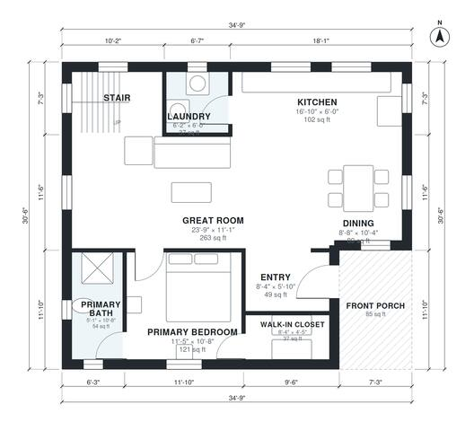

# 3 Bedroom Cabin Plans: 1,510 Sq Ft Story-and-a-Half Design

A rustic story-and-a-half cabin of about 139 m² (about 1,500 sq ft) of living space, plus a front porch. The main floor has an open great room, kitchen and dining area, a laundry, and a private primary suite with bath and walk-in closet. A stair rises to a loft that leads to two bedrooms and a shared bath, and the lower roof section sits over the main floor.

| | |
|---|---|
| Levels | 2 |
| Footprint | 10.6 m × 9.3 m (35 ft × 31 ft) |
| Rooms | 14 indoor, 2 outdoor |
| Indoor area including garage, from the room grid | about 140 m² (1,506 sq ft) |

## Files here

- `area-schedule.csv` (room schedule)
- `building.json` (rooms, walls, openings as data)
- `plan-level1.dxf` (floor plan, DXF, drawing units: inches)
- `plan-level2.dxf` (floor plan, DXF, drawing units: inches)

## More for this plan

- Plan page with the PDF plan set, IFC and 3D model, and a tool to change the plan: https://floorplan.ai-architectures.com/house-plans/3-bedroom-cabin-plans?utm_source=github-plans&utm_medium=probe&utm_campaign=github
- PDF plan set: https://storage.googleapis.com/20img/house-plans/3-bedroom-cabin-plans/plan-set.pdf
- IFC model: https://storage.googleapis.com/20img/house-plans/3-bedroom-cabin-plans/model.ifc

## Known issues in this drawing

- Kitchen is only 1.84 m wide.
- Bedroom 3 is 8.9 m² (asked for about 12.0 m²).

Concept design generated with AI. Not for construction or permit; verify with a licensed professional.
