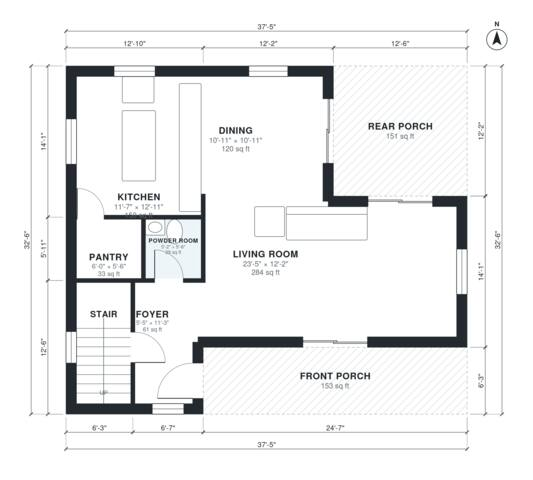

# 3 Bedroom Coastal House Plans: 1,860 Sq Ft Two-Story Design

This is a compact two-story coastal home of about 172 m² (roughly 1,850 sq ft) of living space, not counting the garage. Downstairs, the foyer opens into an open living, dining and kitchen area with a pantry, a powder room and front and rear porches. Upstairs, a central hall serves a primary suite with a walk-in closet and bath, two more bedrooms, a hall bath and a laundry room.

| | |
|---|---|
| Levels | 2 |
| Footprint | 11.4 m × 9.9 m (37 ft × 32 ft) |
| Rooms | 16 indoor, 3 outdoor |
| Indoor area including garage, from the room grid | about 173 m² (1,862 sq ft) |

## Files here

- `area-schedule.csv` (room schedule)
- `building.json` (rooms, walls, openings as data)
- `plan-level1.dxf` (floor plan, DXF, drawing units: inches)
- `plan-level2.dxf` (floor plan, DXF, drawing units: inches)

## More for this plan

- Plan page with the PDF plan set, IFC and 3D model, and a tool to change the plan: https://floorplan.ai-architectures.com/house-plans/3-bedroom-coastal-house-plans?utm_source=github-plans&utm_medium=probe&utm_campaign=github
- PDF plan set: https://storage.googleapis.com/20img/house-plans/3-bedroom-coastal-house-plans/plan-set.pdf
- IFC model: https://storage.googleapis.com/20img/house-plans/3-bedroom-coastal-house-plans/model.ifc

## Known issues in this drawing

- Foyer is 5.6 m² (asked for about 8.0 m²).
- Walk-in Closet is 3.1 m² (asked for about 5.0 m²).
- Hall Bath is only 1.44 m wide.

Concept design generated with AI. Not for construction or permit; verify with a licensed professional.
