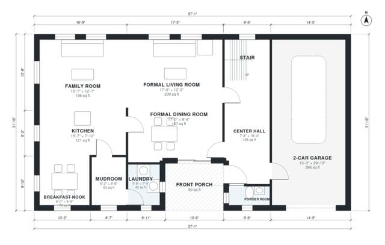

# 3 Bedroom Colonial House Plans: 2,280 Sq Ft, 2-Car Garage

This is a two-story center-hall colonial with about 214 m² (2,300 sq ft) of living space, plus an attached 2-car garage and a front porch. The ground floor has formal living and dining rooms off the center hall, an open kitchen, breakfast nook and family room, and a powder room. A mudroom and laundry sit between the kitchen and the garage. Upstairs are three bedrooms, including a primary suite with its own bath and walk-in closet, and a hall bath.

| | |
|---|---|
| Levels | 2 |
| Footprint | 17.4 m × 9.7 m (57 ft × 32 ft) |
| Rooms | 19 indoor, 2 outdoor |
| Indoor area including garage, from the room grid | about 255 m² (2,740 sq ft) |

## Files here

- `area-schedule.csv` (room schedule)
- `building.json` (rooms, walls, openings as data)
- `plan-level1.dxf` (floor plan, DXF, drawing units: inches)
- `plan-level2.dxf` (floor plan, DXF, drawing units: inches)

## More for this plan

- Plan page with the PDF plan set, IFC and 3D model, and a tool to change the plan: https://floorplan.ai-architectures.com/house-plans/3-bedroom-colonial-house-plans?utm_source=github-plans&utm_medium=probe&utm_campaign=github
- PDF plan set: https://storage.googleapis.com/20img/house-plans/3-bedroom-colonial-house-plans/plan-set.pdf
- IFC model: https://storage.googleapis.com/20img/house-plans/3-bedroom-colonial-house-plans/model.ifc

## Known issues in this drawing

- Mudroom and 2-Car Garage are not directly connected.
- Powder Room is 2.3 m² (asked for about 3.5 m²).
- Walk-in Closet is 5.2 m² (asked for about 7.0 m²).

Concept design generated with AI. Not for construction or permit; verify with a licensed professional.
