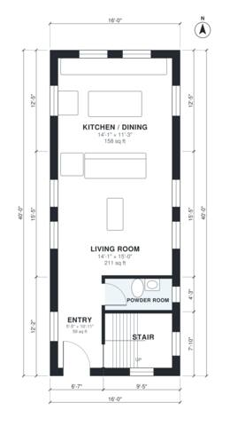

# 3 Bedroom Container Home Plans: 1,280 Sq Ft Two-Story

This two-story container home uses four 40 ft containers, two per floor, for a 16 x 40 ft footprint and about 1,280 sq ft in total. The ground floor has an entry, an open living room and kitchen/dining area, a powder room and the stair. Upstairs, a central hall serves a primary bedroom, two more bedrooms and a shared bath. Every room has natural light.

| | |
|---|---|
| Levels | 2 |
| Footprint | 4.88 m × 12.19 m (16 ft × 40 ft) |
| Rooms | 11 indoor, 0 outdoor |
| Indoor area including garage, from the room grid | about 119 m² (1,281 sq ft) |

## Files here

- `area-schedule.csv` (room schedule)
- `building.json` (rooms, walls, openings as data)
- `plan-level1.dxf` (floor plan, DXF, drawing units: inches)
- `plan-level2.dxf` (floor plan, DXF, drawing units: inches)

## More for this plan

- Plan page with the PDF plan set, IFC and 3D model, and a tool to change the plan: https://floorplan.ai-architectures.com/house-plans/3-bedroom-container-home-plans?utm_source=github-plans&utm_medium=probe&utm_campaign=github
- PDF plan set: https://storage.googleapis.com/20img/house-plans/3-bedroom-container-home-plans/plan-set.pdf
- IFC model: https://storage.googleapis.com/20img/house-plans/3-bedroom-container-home-plans/model.ifc

## Known issues in this drawing

- Bathroom is 3.3 m² (asked for about 5.0 m²).

Concept design generated with AI. Not for construction or permit; verify with a licensed professional.
