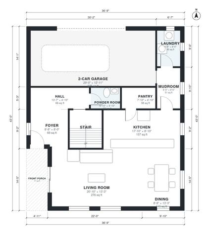

# 3 Bedroom Contemporary House Plans | Two-Story, 2,130 Sq Ft

This two-story contemporary home has about 200 m² (roughly 2,160 sq ft) of living space, plus an attached 2-car garage. The ground floor has a front porch, an open living, dining and kitchen area, a pantry, a powder room, a laundry and a mudroom to the garage. Upstairs are the primary suite with ensuite and walk-in closet, two more bedrooms and a hall bath, all off a central hall.

| | |
|---|---|
| Levels | 2 |
| Footprint | 11.2 m × 13.1 m (37 ft × 43 ft) |
| Rooms | 19 indoor, 2 outdoor |
| Indoor area including garage, from the room grid | about 238 m² (2,557 sq ft) |

## Files here

- `area-schedule.csv` (room schedule)
- `building.json` (rooms, walls, openings as data)
- `plan-level1.dxf` (floor plan, DXF, drawing units: inches)
- `plan-level2.dxf` (floor plan, DXF, drawing units: inches)

## More for this plan

- Plan page with the PDF plan set, IFC and 3D model, and a tool to change the plan: https://floorplan.ai-architectures.com/house-plans/3-bedroom-contemporary-house-plans?utm_source=github-plans&utm_medium=probe&utm_campaign=github
- PDF plan set: https://storage.googleapis.com/20img/house-plans/3-bedroom-contemporary-house-plans/plan-set.pdf
- IFC model: https://storage.googleapis.com/20img/house-plans/3-bedroom-contemporary-house-plans/model.ifc

## Known issues in this drawing

- Laundry is 4.2 m² (asked for about 6.0 m²).
- Bedroom 3 is only 2.44 m wide.

Concept design generated with AI. Not for construction or permit; verify with a licensed professional.
