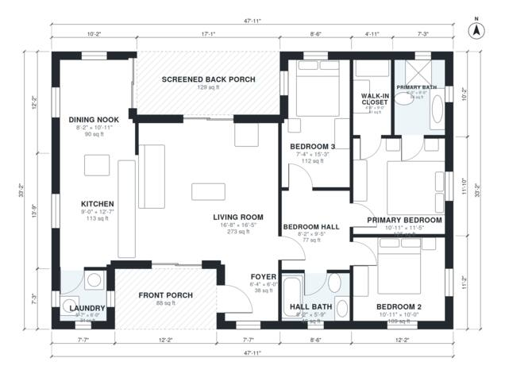

# 3 Bedroom Cottage House Plans: 1,370 Sq Ft, 2 Bath Layout

This is a single-story 3-bedroom, 2-bath cottage of about 148 m² (roughly 1,590 sq ft) including porches, or about 130 m² (1,400 sq ft) of indoor living space. A front porch leads into a foyer and an open living, kitchen and dining area. A screened back porch sits off the living area, and the three bedrooms are grouped along a private hall at the east end, with the primary suite at the far corner. The laundry is next to the kitchen near the front porch.

| | |
|---|---|
| Levels | 1 |
| Footprint | 14.6 m × 10.1 m (48 ft × 33 ft) |
| Rooms | 12 indoor, 2 outdoor |
| Indoor area including garage, from the room grid | about 127 m² (1,371 sq ft) |

## Files here

- `area-schedule.csv` (room schedule)
- `building.json` (rooms, walls, openings as data)
- `plan-level1.dxf` (floor plan, DXF, drawing units: inches)

## More for this plan

- Plan page with the PDF plan set, IFC and 3D model, and a tool to change the plan: https://floorplan.ai-architectures.com/house-plans/3-bedroom-cottage-house-plans?utm_source=github-plans&utm_medium=probe&utm_campaign=github
- PDF plan set: https://storage.googleapis.com/20img/house-plans/3-bedroom-cottage-house-plans/plan-set.pdf
- IFC model: https://storage.googleapis.com/20img/house-plans/3-bedroom-cottage-house-plans/model.ifc

## Known issues in this drawing

- Laundry is 3.1 m² (asked for about 5.0 m²).
- Foyer is 3.6 m² (asked for about 5.0 m²).
- Dining Nook is only 2.50 m wide.
- Bedroom 3 is only 2.24 m wide.

Concept design generated with AI. Not for construction or permit; verify with a licensed professional.
