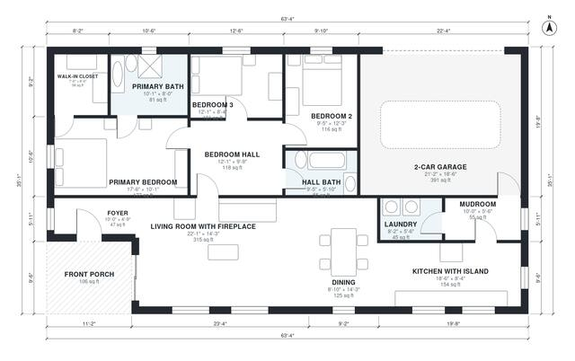

# 3 Bedroom Craftsman House Plans: 1,680 Sq Ft One-Story

This is a single-storey craftsman home of about 160 m² (about 1,725 sq ft) of living space, plus a 2-car garage and a front porch. The porch opens to a foyer and the living room with its fireplace, which flows into the dining area and island kitchen. A mudroom and laundry sit between the kitchen and the garage. The three bedrooms are in a quiet wing off a central hall, and the primary suite has its own bath and walk-in closet.

| | |
|---|---|
| Levels | 1 |
| Footprint | 19.3 m × 10.7 m (63 ft × 35 ft) |
| Rooms | 14 indoor, 1 outdoor |
| Indoor area including garage, from the room grid | about 197 m² (2,117 sq ft) |

## Files here

- `area-schedule.csv` (room schedule)
- `building.json` (rooms, walls, openings as data)
- `plan-level1.dxf` (floor plan, DXF, drawing units: inches)

## More for this plan

- Plan page with the PDF plan set, IFC and 3D model, and a tool to change the plan: https://floorplan.ai-architectures.com/house-plans/3-bedroom-craftsman-house-plans?utm_source=github-plans&utm_medium=probe&utm_campaign=github
- PDF plan set: https://storage.googleapis.com/20img/house-plans/3-bedroom-craftsman-house-plans/plan-set.pdf
- IFC model: https://storage.googleapis.com/20img/house-plans/3-bedroom-craftsman-house-plans/model.ifc

## Known issues in this drawing

- Foyer is 4.4 m² (asked for about 6.0 m²).

Concept design generated with AI. Not for construction or permit; verify with a licensed professional.
