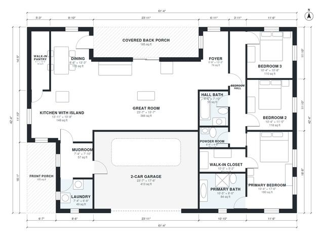

# 3 Bedroom Farmhouse Plans: 1,880 Sq Ft Single-Story Layout

A single-story modern farmhouse of about 176 m² (1,900 sq ft) of living space, plus a 40 m² two-car garage and front and back porches. An open great room, kitchen with island and dining area sits at the front, with a walk-in pantry. A combined mudroom and laundry connects the garage to the kitchen. The three bedrooms are in a separate wing off a hall, with the primary suite at the end.

| | |
|---|---|
| Levels | 1 |
| Footprint | 18.7 m × 12.9 m (61 ft × 42 ft) |
| Rooms | 16 indoor, 2 outdoor |
| Indoor area including garage, from the room grid | about 216 m² (2,326 sq ft) |

## Files here

- `area-schedule.csv` (room schedule)
- `building.json` (rooms, walls, openings as data)
- `plan-level1.dxf` (floor plan, DXF, drawing units: inches)

## More for this plan

- Plan page with the PDF plan set, IFC and 3D model, and a tool to change the plan: https://floorplan.ai-architectures.com/house-plans/3-bedroom-farmhouse-plans?utm_source=github-plans&utm_medium=probe&utm_campaign=github
- PDF plan set: https://storage.googleapis.com/20img/house-plans/3-bedroom-farmhouse-plans/plan-set.pdf
- IFC model: https://storage.googleapis.com/20img/house-plans/3-bedroom-farmhouse-plans/model.ifc

## Known issues in this drawing

- Front Porch and Foyer are not directly connected.

Concept design generated with AI. Not for construction or permit; verify with a licensed professional.
