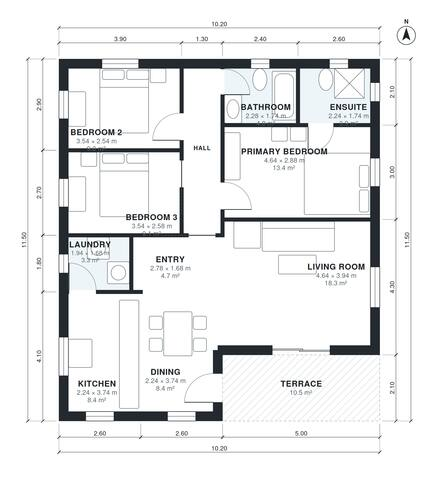

# 3 Bedroom House Plan 105 m2: 1,150 Sq Ft, 2 Baths, Terrace

This is a compact single-storey home of about 105 m² of indoor space, plus a 10.5 m² terrace on a 10.2 x 11.5 m footprint. The kitchen, dining and living areas are open to each other and to the entry, and the living and dining areas open onto the terrace. A hall serves the three bedrooms and the shared bath. The primary bedroom has its own ensuite, and the laundry is near the entry.

| | |
|---|---|
| Levels | 1 |
| Footprint | 10.2 m × 11.5 m (33 ft × 38 ft) |
| Rooms | 11 indoor, 1 outdoor |
| Indoor area including garage, from the room grid | about 107 m² (1,150 sq ft) |

## Files here

- `area-schedule.csv` (room schedule)
- `building.json` (rooms, walls, openings as data)
- `plan-level1.dxf` (floor plan, DXF, drawing units: millimetres)

## More for this plan

- Plan page with the PDF plan set, IFC and 3D model, and a tool to change the plan: https://floorplan.ai-architectures.com/house-plans/3-bedroom-house-plan-105-m2?utm_source=github-plans&utm_medium=probe&utm_campaign=github
- PDF plan set: https://storage.googleapis.com/20img/house-plans/3-bedroom-house-plan-105-m2/plan-set.pdf
- IFC model: https://storage.googleapis.com/20img/house-plans/3-bedroom-house-plan-105-m2/model.ifc

## Known issues in this drawing

- Dining is only 2.24 m wide.
- Primary Bedroom is only 2.88 m wide.
- Ensuite is 3.9 m² (asked for about 5.5 m²).

Concept design generated with AI. Not for construction or permit; verify with a licensed professional.
