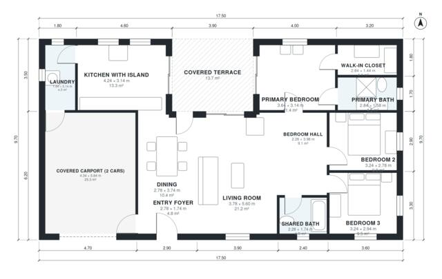

# 3 Bedroom House Plan 125 m2 | 1,370 Sq Ft Single Story

A compact single-storey home of about 170 m² overall, with roughly 130 m² of living space plus a covered 2-car carport and a covered terrace. The open kitchen with island, dining and living area flows out to the terrace. The primary suite with walk-in closet and bath, two further bedrooms and a shared bath are grouped off a bedroom hall, and the laundry is reachable from both the kitchen and the carport.

| | |
|---|---|
| Levels | 1 |
| Footprint | 17.5 m × 9.7 m (57 ft × 32 ft) |
| Rooms | 13 indoor, 1 outdoor |
| Indoor area including garage, from the room grid | about 156 m² (1,680 sq ft) |

## Files here

- `area-schedule.csv` (room schedule)
- `building.json` (rooms, walls, openings as data)
- `plan-level1.dxf` (floor plan, DXF, drawing units: millimetres)

## More for this plan

- Plan page with the PDF plan set, IFC and 3D model, and a tool to change the plan: https://floorplan.ai-architectures.com/house-plans/3-bedroom-house-plan-125-m2?utm_source=github-plans&utm_medium=probe&utm_campaign=github
- PDF plan set: https://storage.googleapis.com/20img/house-plans/3-bedroom-house-plan-125-m2/plan-set.pdf
- IFC model: https://storage.googleapis.com/20img/house-plans/3-bedroom-house-plan-125-m2/model.ifc

## Known issues in this drawing

- Dining has no window.

Concept design generated with AI. Not for construction or permit; verify with a licensed professional.
