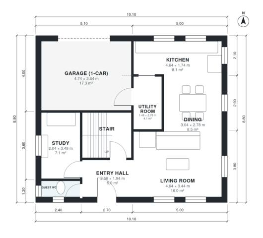

# 3 Bedroom House Plan 135 m2 | 2-Story, 2.5 Bath, Garage

A compact two-storey house of about 135 m² of living space, with a 1-car garage that is not counted in that figure. The ground floor has an open kitchen, living and dining area, a study, a guest WC and a utility room next to the garage. Upstairs, three bedrooms (one with an ensuite) and the family bath open off a central landing hall, and there is a terrace over the garage.

| | |
|---|---|
| Levels | 2 |
| Footprint | 10.1 m × 8.8 m (33 ft × 29 ft) |
| Rooms | 16 indoor, 1 outdoor |
| Indoor area including garage, from the room grid | about 157 m² (1,686 sq ft) |

## Files here

- `area-schedule.csv` (room schedule)
- `building.json` (rooms, walls, openings as data)
- `plan-level1.dxf` (floor plan, DXF, drawing units: millimetres)
- `plan-level2.dxf` (floor plan, DXF, drawing units: millimetres)

## More for this plan

- Plan page with the PDF plan set, IFC and 3D model, and a tool to change the plan: https://floorplan.ai-architectures.com/house-plans/3-bedroom-house-plan-135-m2?utm_source=github-plans&utm_medium=probe&utm_campaign=github
- PDF plan set: https://storage.googleapis.com/20img/house-plans/3-bedroom-house-plan-135-m2/plan-set.pdf
- IFC model: https://storage.googleapis.com/20img/house-plans/3-bedroom-house-plan-135-m2/model.ifc

## Known issues in this drawing

- Kitchen is only 1.74 m wide.
- Bedroom 3 is 8.5 m² (asked for about 12.0 m²).
- Bedroom 3 is only 2.34 m wide.

Concept design generated with AI. Not for construction or permit; verify with a licensed professional.
