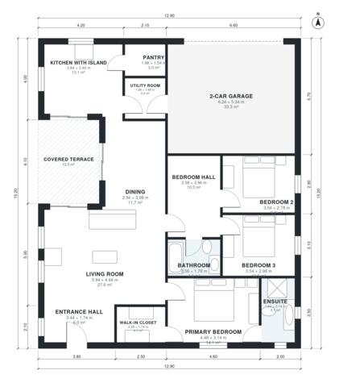

# 3 Bedroom House Plan 145 m2: 1,570 Sq Ft Single-Story

This is a single-storey, split-bedroom house of roughly 140 m² of living space, plus a 33 m² two-car garage and a 12 m² covered terrace. The kitchen with island and pantry flows into the dining and living areas, with the terrace opening off both. The primary suite (with ensuite and walk-in closet) is on one side of the living room. Two bedrooms and a bath share a hall on the other side. The garage enters through the utility room.

| | |
|---|---|
| Levels | 1 |
| Footprint | 12.9 m × 15.2 m (42 ft × 50 ft) |
| Rooms | 14 indoor, 1 outdoor |
| Indoor area including garage, from the room grid | about 184 m² (1,978 sq ft) |

## Files here

- `area-schedule.csv` (room schedule)
- `building.json` (rooms, walls, openings as data)
- `plan-level1.dxf` (floor plan, DXF, drawing units: millimetres)

## More for this plan

- Plan page with the PDF plan set, IFC and 3D model, and a tool to change the plan: https://floorplan.ai-architectures.com/house-plans/3-bedroom-house-plan-145-m2?utm_source=github-plans&utm_medium=probe&utm_campaign=github
- PDF plan set: https://storage.googleapis.com/20img/house-plans/3-bedroom-house-plan-145-m2/plan-set.pdf
- IFC model: https://storage.googleapis.com/20img/house-plans/3-bedroom-house-plan-145-m2/model.ifc

## Known issues in this drawing

- None found by the automatic checks.

Concept design generated with AI. Not for construction or permit; verify with a licensed professional.
