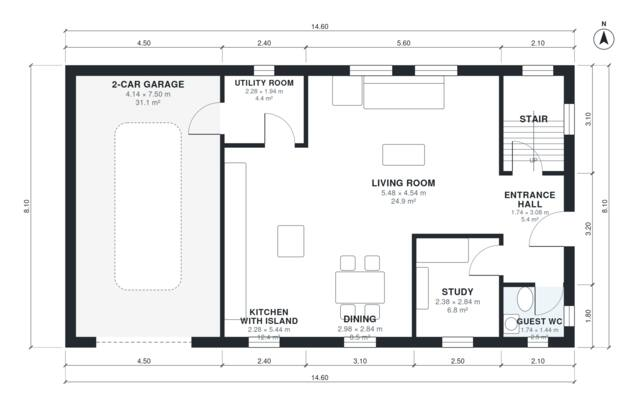

# 3 Bedroom House Plan 160 m2: Two-Story with 2-Car Garage

A two-storey contemporary house with about 157 m² of living space, plus a 40 m² two-car garage. The ground floor is an open kitchen with island, dining and living area, with a study, guest WC and utility room that connects the kitchen to the garage. Upstairs are the primary suite with dressing room and bath, two bedrooms and a family bath, with a roof terrace over the living room.

| | |
|---|---|
| Levels | 2 |
| Footprint | 14.6 m × 8.1 m (48 ft × 27 ft) |
| Rooms | 17 indoor, 1 outdoor |
| Indoor area including garage, from the room grid | about 200 m² (2,148 sq ft) |

## Files here

- `area-schedule.csv` (room schedule)
- `building.json` (rooms, walls, openings as data)
- `plan-level1.dxf` (floor plan, DXF, drawing units: millimetres)
- `plan-level2.dxf` (floor plan, DXF, drawing units: millimetres)

## More for this plan

- Plan page with the PDF plan set, IFC and 3D model, and a tool to change the plan: https://floorplan.ai-architectures.com/house-plans/3-bedroom-house-plan-160-m2?utm_source=github-plans&utm_medium=probe&utm_campaign=github
- PDF plan set: https://storage.googleapis.com/20img/house-plans/3-bedroom-house-plan-160-m2/plan-set.pdf
- IFC model: https://storage.googleapis.com/20img/house-plans/3-bedroom-house-plan-160-m2/model.ifc

## Known issues in this drawing

- Primary Bedroom is only 2.50 m wide.

Concept design generated with AI. Not for construction or permit; verify with a licensed professional.
