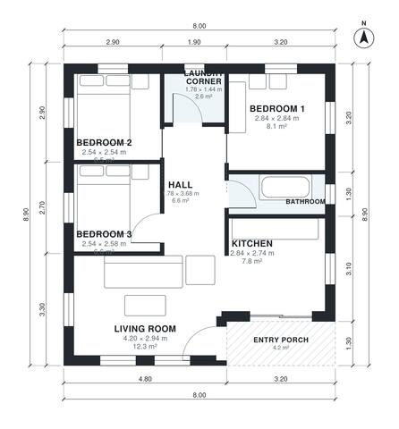

# 3 Bedroom House Plans 70 m2: 720 Sq Ft Single-Story Layout

A compact single-storey home of about 71 m² of living space including the entry porch. It has three small bedrooms on one side, a shared bathroom, an open kitchen and living area, a laundry corner and a covered entry porch. The revision gives the bedrooms and bath a proper hall, makes the kitchen and bathroom more usable, and moves the laundry off Bedroom 1's door.

| | |
|---|---|
| Levels | 1 |
| Footprint | 8.0 m × 8.9 m (26 ft × 29 ft) |
| Rooms | 8 indoor, 1 outdoor |
| Indoor area including garage, from the room grid | about 67 m² (722 sq ft) |

## Files here

- `area-schedule.csv` (room schedule)
- `building.json` (rooms, walls, openings as data)
- `plan-level1.dxf` (floor plan, DXF, drawing units: millimetres)

## More for this plan

- Plan page with the PDF plan set, IFC and 3D model, and a tool to change the plan: https://floorplan.ai-architectures.com/house-plans/3-bedroom-house-plan-70-m2?utm_source=github-plans&utm_medium=probe&utm_campaign=github
- PDF plan set: https://storage.googleapis.com/20img/house-plans/3-bedroom-house-plan-70-m2/plan-set.pdf
- IFC model: https://storage.googleapis.com/20img/house-plans/3-bedroom-house-plan-70-m2/model.ifc

## Known issues in this drawing

- Living Room is only 2.94 m wide.
- Laundry Corner is 2.6 m² (asked for about 3.5 m²).
- Bathroom is only 1.18 m wide.

Concept design generated with AI. Not for construction or permit; verify with a licensed professional.
