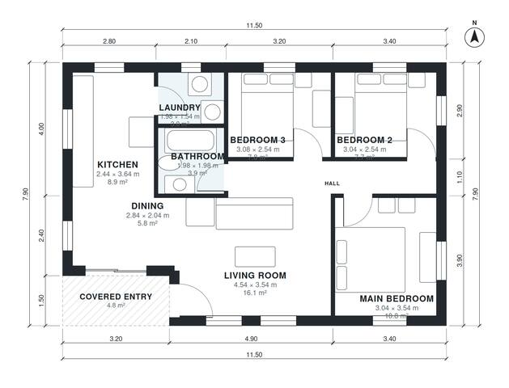

# 3 Bedroom House Plan 85 m2: 930 Sq Ft Single-Story Layout

This is a compact single-storey home of about 86 m² of living space, plus a 4.8 m² covered entry. The open kitchen, dining and living area sits on the west side and the entry opens into it. The three bedrooms, a shared bathroom and a small laundry are grouped around a central hall, so the bedrooms are private and the plan wastes little space. The dining zone is small, so the table fits best as a breakfast-style setup.

| | |
|---|---|
| Levels | 1 |
| Footprint | 11.5 m × 7.9 m (38 ft × 26 ft) |
| Rooms | 9 indoor, 1 outdoor |
| Indoor area including garage, from the room grid | about 86 m² (926 sq ft) |

## Files here

- `area-schedule.csv` (room schedule)
- `building.json` (rooms, walls, openings as data)
- `plan-level1.dxf` (floor plan, DXF, drawing units: millimetres)

## More for this plan

- Plan page with the PDF plan set, IFC and 3D model, and a tool to change the plan: https://floorplan.ai-architectures.com/house-plans/3-bedroom-house-plan-85-m2?utm_source=github-plans&utm_medium=probe&utm_campaign=github
- PDF plan set: https://storage.googleapis.com/20img/house-plans/3-bedroom-house-plan-85-m2/plan-set.pdf
- IFC model: https://storage.googleapis.com/20img/house-plans/3-bedroom-house-plan-85-m2/model.ifc

## Known issues in this drawing

- Dining is 5.8 m² (asked for about 8.0 m²).
- Dining is only 2.04 m wide.

Concept design generated with AI. Not for construction or permit; verify with a licensed professional.
