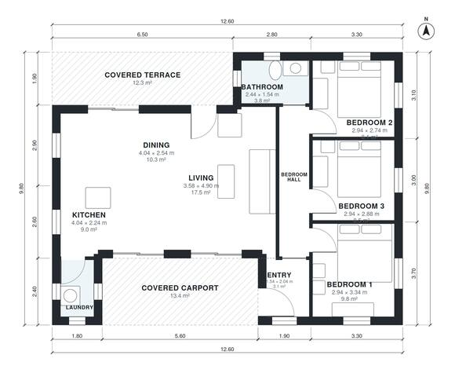

# 3 Bedroom House Plan 95 m2: 1,050 Sq Ft Single-Story Layout

A compact single-storey home with about 95 m² of indoor living space, plus a covered carport for one car at the front and a covered terrace at the back. It has an open kitchen, dining and living area that opens onto the terrace, and a laundry off the kitchen. The three bedrooms and the single bathroom open off a short hall, away from the living areas. The proposed revision gives the carport a usable depth and gives the bedrooms and dining room more comfortable proportions.

| | |
|---|---|
| Levels | 1 |
| Footprint | 12.6 m × 9.8 m (41 ft × 32 ft) |
| Rooms | 10 indoor, 2 outdoor |
| Indoor area including garage, from the room grid | about 98 m² (1,052 sq ft) |

## Files here

- `area-schedule.csv` (room schedule)
- `building.json` (rooms, walls, openings as data)
- `plan-level1.dxf` (floor plan, DXF, drawing units: millimetres)

## More for this plan

- Plan page with the PDF plan set, IFC and 3D model, and a tool to change the plan: https://floorplan.ai-architectures.com/house-plans/3-bedroom-house-plan-95-m2?utm_source=github-plans&utm_medium=probe&utm_campaign=github
- PDF plan set: https://storage.googleapis.com/20img/house-plans/3-bedroom-house-plan-95-m2/plan-set.pdf
- IFC model: https://storage.googleapis.com/20img/house-plans/3-bedroom-house-plan-95-m2/model.ifc

## Known issues in this drawing

- Laundry is 2.4 m² (asked for about 4.5 m²).
- Laundry is only 1.20 m wide.
- Dining is only 2.54 m wide.
- Bedroom 1 is only 2.94 m wide.

Concept design generated with AI. Not for construction or permit; verify with a licensed professional.
