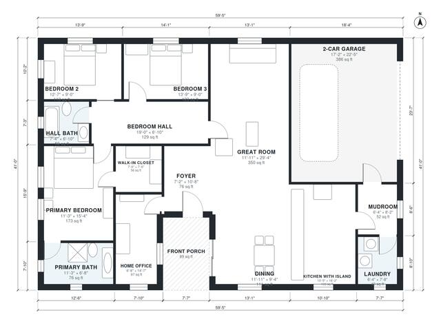

# 3 Bedroom House Plans With Office: 1,910 Sq Ft One Story

This is a single-story, 3-bedroom, 2-bath farmhouse of about 176 m² (1,900 sq ft) of living space, plus a 2-car garage and a front porch. The open kitchen with island, dining and great room sit at the center. The home office opens off the foyer, and the three bedrooms sit in a quiet wing off a hall. The garage connects through a mudroom and laundry.

| | |
|---|---|
| Levels | 1 |
| Footprint | 18.1 m × 12.5 m (59 ft × 41 ft) |
| Rooms | 15 indoor, 1 outdoor |
| Indoor area including garage, from the room grid | about 218 m² (2,346 sq ft) |

## Files here

- `area-schedule.csv` (room schedule)
- `building.json` (rooms, walls, openings as data)
- `plan-level1.dxf` (floor plan, DXF, drawing units: inches)

## More for this plan

- Plan page with the PDF plan set, IFC and 3D model, and a tool to change the plan: https://floorplan.ai-architectures.com/house-plans/3-bedroom-house-plans-with-office?utm_source=github-plans&utm_medium=probe&utm_campaign=github
- PDF plan set: https://storage.googleapis.com/20img/house-plans/3-bedroom-house-plans-with-office/plan-set.pdf
- IFC model: https://storage.googleapis.com/20img/house-plans/3-bedroom-house-plans-with-office/model.ifc

## Known issues in this drawing

- None found by the automatic checks.

Concept design generated with AI. Not for construction or permit; verify with a licensed professional.
