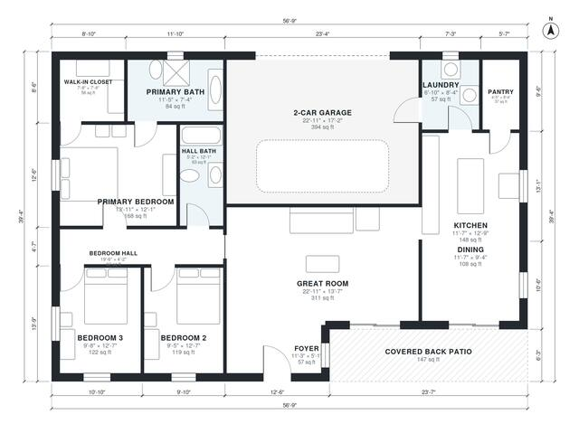

# 3 Bedroom House Plans: Single-Story, 2 Bath, 2-Car Garage

This is a single-story, 3-bedroom, 2-bath ranch of about 1,690 sq ft of heated space, plus a 2-car garage and a 147 sq ft covered back patio. The great room, kitchen and dining are open to each other, and the dining area opens onto the patio. The primary suite with its ensuite and walk-in closet is at the end of the bedroom hall, and the garage enters through the laundry into the kitchen.

| | |
|---|---|
| Levels | 1 |
| Footprint | 17.3 m × 12.0 m (57 ft × 39 ft) |
| Rooms | 14 indoor, 1 outdoor |
| Indoor area including garage, from the room grid | about 194 m² (2,087 sq ft) |

## Files here

- `area-schedule.csv` (room schedule)
- `building.json` (rooms, walls, openings as data)
- `plan-level1.dxf` (floor plan, DXF, drawing units: inches)

## More for this plan

- Plan page with the PDF plan set, IFC and 3D model, and a tool to change the plan: https://floorplan.ai-architectures.com/house-plans/3-bedroom-house-plans?utm_source=github-plans&utm_medium=probe&utm_campaign=github
- PDF plan set: https://storage.googleapis.com/20img/house-plans/3-bedroom-house-plans/plan-set.pdf
- IFC model: https://storage.googleapis.com/20img/house-plans/3-bedroom-house-plans/model.ifc

## Known issues in this drawing

- None found by the automatic checks.

Concept design generated with AI. Not for construction or permit; verify with a licensed professional.
