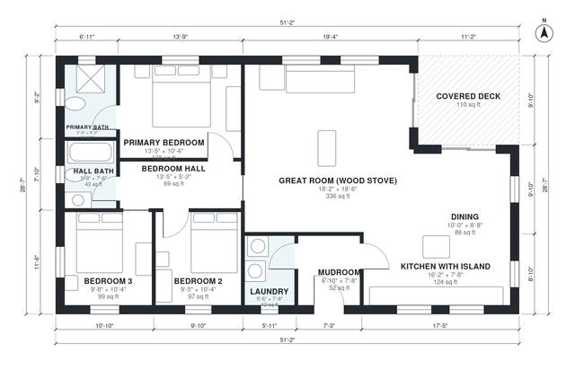

# 3 Bedroom Modern Cabin Plans: 1,350 Sq Ft Shed Roof Design

This is a single-story, 3-bedroom, 2-bath modern cabin of about 130 m² (1,400 sq ft) including the covered deck, under a shed roof. The large great room combines the kitchen island, dining and wood stove, and opens to a covered deck on the east side. The bedrooms are grouped in a quiet west wing off a short hall, and the mudroom and laundry sit at the entry side.

| | |
|---|---|
| Levels | 1 |
| Footprint | 15.6 m × 8.7 m (51 ft × 29 ft) |
| Rooms | 11 indoor, 1 outdoor |
| Indoor area including garage, from the room grid | about 126 m² (1,351 sq ft) |

## Files here

- `area-schedule.csv` (room schedule)
- `building.json` (rooms, walls, openings as data)
- `plan-level1.dxf` (floor plan, DXF, drawing units: inches)

## More for this plan

- Plan page with the PDF plan set, IFC and 3D model, and a tool to change the plan: https://floorplan.ai-architectures.com/house-plans/3-bedroom-modern-cabin-plans?utm_source=github-plans&utm_medium=probe&utm_campaign=github
- PDF plan set: https://storage.googleapis.com/20img/house-plans/3-bedroom-modern-cabin-plans/plan-set.pdf
- IFC model: https://storage.googleapis.com/20img/house-plans/3-bedroom-modern-cabin-plans/model.ifc

## Known issues in this drawing

- Primary Bath is 4.2 m² (asked for about 6.0 m²).
- Kitchen with Island is only 2.34 m wide.

Concept design generated with AI. Not for construction or permit; verify with a licensed professional.
